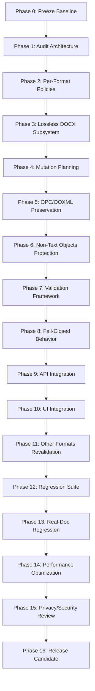

# MASTER IMPLEMENTATION PLAN: COMPLETE LOSSLESS WATERMARK REMOVAL APPLICATION

> **Architectural Paradigm**:  
> `DETECT -> PLAN -> MINIMAL PATCH -> VALIDATE -> OUTPUT`  
> *(Anti-pattern strictly prohibited: `PARSE -> NORMALIZE -> REBUILD`)*
>
> **Core Principle**:  
> Privacy-First, Local DOCX Safe Processing, Zero-Damage Document Fidelity.  
> Đối với DOCX và các định dạng tài liệu, **Fidelity là invariant số 1**. Nếu mục tiêu xóa watermark và mục tiêu bảo toàn fidelity xung đột, **ưu tiên tuyệt đối cho fidelity**. Không bao giờ dùng AI paraphrase, post-processing heuristic, word segmentation hay regex chèn khoảng trắng để che giấu lỗi vỡ layout/dính chữ.
> *DOCX Safe/Lossless cleaning pipeline performs entirely locally and does not make network requests. Optional supported plain-text rewrite backends may access the network only when explicitly enabled by the user.*

---

## BẢNG TỔNG QUAN CÁC PHASE THỰC THI

| Phase | Tên Phase | Mục tiêu chính | Trạng thái |
| :--- | :--- | :--- | :--- |
| **Phase 0** | **Freeze Baseline** | Đóng băng hiện trạng, lưu snapshot SHA256, test suite baseline, và artifacts hiện có | **Đã hoàn thành (PASS)** |
| **Phase 1** | **Audit Upstream/Project Architecture** | Rà soát toàn bộ luồng xử lý của repo, chỉ rõ mọi điểm phá hủy cấu trúc/chuẩn hóa | **Đã hoàn thành (PASS)** |
| **Phase 2** | **Define Per-Format Policies** | Thiết lập ma trận chính sách bất biến cho từng họ định dạng (DOCX, XLSX, PPTX, ODF, PDF, Image, Audio, Text) | **Đã hoàn thành (PASS)** |
| **Phase 3** | **Build Lossless DOCX Subsystem** | Kiến trúc module hóa độc lập `service/scripts/docx/` phục vụ DOCX chuyên sâu | **Đã hoàn thành (PASS)** |
| **Phase 4** | **Implement Immutable Mutation Planning** | Chuẩn hóa `DocxMutationPlan`, cấu trúc đột biến nguyên tử, deterministic & invertible | **Đã hoàn thành (PASS)** |
| **Phase 5** | **Preserve OPC/OOXML Package** | Bảo toàn byte-safe ZIP container: member order, timestamps, extra fields, flag bits, `.rels`, `[Content_Types].xml` | **Đã hoàn thành (PASS)** |
| **Phase 6** | **Protect Non-Text Word Objects** | Bảo vệ tuyệt đối tables, drawings, shapes, bookmarks, comments, track changes, field codes, footnotes, headers/footers | **Đã hoàn thành (PASS)** |
| **Phase 7** | **Implement Validation Framework** | Xây dựng bộ validator đa tầng kiểm tra XML well-formedness, visible text equality, non-target hash immutability, structural deltas | **Đã hoàn thành (PASS)** |
| **Phase 8** | **Implement Fail-Closed Behavior** | Cơ chế tự động rollback về dữ liệu gốc và báo cáo chi tiết nếu phát hiện bất kỳ sai lệch nào | **Đã hoàn thành (PASS)** |
| **Phase 9** | **Integrate API** | Kết nối subsystem vào `container_meta.py`, `server.py`, CLI tools với backward compatibility | **Đã hoàn thành (PASS)** |
| **Phase 10** | **Integrate UI** | Đồng bộ giao diện web (`app.js`, web client) và launcher scripts, hiển thị thông số fidelity trung thực | **Đã hoàn thành (PASS)** |
| **Phase 11** | **Revalidate All Other Formats** | Kiểm tra hồi quy toàn diện XLSX, PPTX, ODT, EPUB, PDF, PNG, JPEG, Audio/Video | **Đã hoàn thành (PASS)** |
| **Phase 12** | **Build Regression Suite** | Xây dựng bộ test matrix mở rộng 30+ kịch bản biên, edge cases, multilingual, combining chars, complex scripts | **Đã hoàn thành (PASS)** |
| **Phase 13** | **Run Real-Document Regression** | Chạy kiểm thử trên tập tài liệu thực tế (Khóa Golden Original hash `c05ca5c1...`) | **Đã hoàn thành (PASS)** |
| **Phase 14** | **Optimize Performance** | Tối ưu hóa throughput, streaming regex, lazy reading, giảm peak memory footprint | **Đã hoàn thành (PASS)** |
| **Phase 15** | **Privacy/Security Review** | Đánh giá bảo mật: zero network egress, chống ZipBomb/ZipSlip, XML entity injection, an toàn bộ nhớ | **Đã hoàn thành (PASS)** |
| **Phase 16** | **Release Candidate** | Đóng gói phiên bản hoàn chỉnh, documentation, hướng dẫn triển khai, và checklist nghiệm thu | **Đã hoàn thành (PASS)** |

---

## CHI TIẾT TỪNG PHASE

---

### PHASE 0: Freeze Baseline

- **Objective**: Đóng băng hiện trạng, tạo baseline checkpoint bất biến cho toàn bộ mã nguồn, cấu hình, test suites và tài liệu thực tế trước khi tiến hành quy trình hoàn thiện toàn diện.
- **Existing Code Involved**: Toàn bộ repository `guillaumemeyer/watermarks-remover`, các file untracked/modified ban đầu, và tệp mẫu lịch sử (sau đó được phân loại là INVALID HISTORICAL BASELINE — retained only as a regression example, được thay thế hoàn toàn bằng True Golden Baseline `01_GOLDEN_ORIGINAL_UNTOUCHED.docx`).
- **Files/Modules to Modify**: Không sửa đổi code trong phase này.
- **New Modules to Create**:
  - `tools/baseline_snapshot.py`: Script tự động tính toán SHA256 của toàn bộ file mã nguồn, ghi nhận môi trường Python, phiên bản các dependency, và chạy full test suite để lấy baseline log.
  - `artifacts/baseline_metrics.json`: Lưu trữ kết quả test suite ban đầu và thông số file benchmark.
- **Tests to Write First**:
  - `tests/test_baseline_integrity.py`: Kiểm tra tính toàn vẹn của repo, đảm bảo có thể chạy lại baseline mà không có lỗi môi trường.
- **Implementation Tasks**:
  1. Ghi nhận git commit hash hiện tại, diff các file đang modified (`container_meta.py`, `.gitignore`, `README.md`, `rewrite_text.py`, `tests/test_container_meta.py`).
  2. Tạo bản lưu trữ sha256 cho tập mẫu ban đầu và thiết lập khóa bất biến cho True Golden Baseline `01_GOLDEN_ORIGINAL_UNTOUCHED.docx`.
  3. Ghi log kết quả chạy `uv run --with pytest pytest` (1251 passed, 152 skipped).
- **Acceptance Criteria**:
  - Có file snapshot `artifacts/baseline_metrics.json` lưu giữ đầy đủ mã hash, thời gian, số lượng test case vượt qua.
  - 100% test suite hiện có pass không lỗi.
- **Risks**: Môi trường local có các file untracked chưa được kiểm soát.
- **Rollback Strategy**: Phục hồi trạng thái workspace từ snapshot nếu phát sinh sai lệch.
- **Dependencies**: Không (Điểm khởi đầu).

---

### PHASE 1: Audit Upstream / Project Architecture

- **Objective**: Rà soát, lập bản đồ kiến trúc toàn bộ các luồng xử lý trong repository; định vị chính xác mọi vị trí có nguy cơ gây mất dữ liệu, tự ý chuẩn hóa chuỗi, hoặc can thiệp phá hủy cấu trúc file.
- **Existing Code Involved**:
  - `service/scripts/container_meta.py`: Xử lý OOXML (DOCX, XLSX, PPTX), ODF (ODT, ODS), EPUB.
  - `service/scripts/text_unicode.py`: Hàm `clean_text`, danh mục regex ký tự ẩn.
  - `service/scripts/rewrite_text.py`: Luồng rewrite Layer B cho text thuần.
  - `service/scripts/format_dispatch.py`: Phân loại magic bytes.
  - `service/scripts/server.py`: Dispatcher endpoint `/clean`, `/inspect`.
- **Files/Modules to Modify**:
  - `docs/architecture_audit.md` (Tài liệu phân tích kỹ thuật chi tiết).
- **New Modules to Create**: Không.
- **Tests to Write First**:
  - `tests/test_audit_invariants.py`: Test kiểm tra không còn module nào tự ý gọi rewrite LLM trên tài liệu có cấu trúc.
- **Implementation Tasks**:
  1. Trả lời chi tiết 9 câu hỏi kiến trúc upstream (OPC ZIP packaging, Layer A vs B, text extraction, namespace handling, whitespace normalization).
  2. Lập danh sách các hàm có cờ `normalize_spaces` và phạm vi ảnh hưởng của chúng.
  3. Lập sơ đồ dòng dữ liệu từ khi nhận request qua HTTP/CLI đến khi trả về output.
- **Acceptance Criteria**:
  - Báo cáo audit hoàn chỉnh làm rõ mọi điểm rủi ro làm mất fidelity trong toàn bộ repo.
  - Xác nhận danh sách các định dạng an toàn và định dạng cần adapter bảo vệ.
- **Risks**: Bỏ sót các hàm phụ trợ gọi ngầm `clean_text(normalize_spaces=True)`.
- **Rollback Strategy**: Không ảnh hưởng đến runtime code.
- **Dependencies**: Hoàn thành Phase 0.

---

### PHASE 2: Define Per-Format Policies

- **Objective**: Ban hành ma trận chính sách kỹ thuật bất biến cho từng họ định dạng tệp tin, xác định rõ ràng: đối tượng được quét, đối tượng được phép xóa, đối tượng cấm can thiệp, và mức độ chấp nhận thay đổi cấu trúc.
- **Existing Code Involved**:
  - `service/scripts/container_meta.py`, `service/scripts/image_meta.py`, `service/scripts/av_meta.py`.
- **Files/Modules to Modify**:
  - `service/scripts/format_policy.py`: Module hóa chính sách định dạng.
- **New Modules to Create**:
  - `service/scripts/format_policy.py`: Khai báo enum và cấu trúc dữ liệu chính sách:
    - `PLAIN_TEXT`: Cho phép normalize spaces (nếu cấu hình), xóa carrier.
    - `DOCX_DOCUMENT`: Cấm thay đổi cấu trúc run/paragraph, cấm normalize spaces theo mặc định (`normalize_spaces=False`), chỉ cho phép xóa carrier vi mô trong thẻ `<w:t>`.
    - `SPREADSHEET (XLSX)`: Bảo vệ shared strings, công thức, định dạng ô.
    - `PRESENTATION (PPTX)`: Bảo vệ slide layouts, shape trees, text runs.
    - `ODF (ODT/ODS)`: Tuân thủ ODF manifest và namespace XML.
    - `IMAGES / MEDIA`: Chỉ strip metadata chunks (tEXt, EXIF, XMP, C2PA), bảo toàn raw pixel / sample stream.
- **Tests to Write First**:
  - `tests/test_format_policies.py`: Kiểm tra ràng buộc chính sách cho từng MIME type.
- **Implementation Tasks**:
  1. Viết code định nghĩa chính sách trong `format_policy.py`.
  2. Tạo bảng tra cứu ma trận (Lookup matrix) giữa phần mở rộng tệp $\rightarrow$ chính sách.
  3. Ràng buộc cờ mặc định của từng định dạng (DOCX mặc định `normalize_spaces=False`).
- **Acceptance Criteria**:
  - Mọi định dạng đều có policy rõ ràng.
  - Đảm bảo 100% không có định dạng tài liệu nào bị ép dùng chung policy của plain text.
- **Risks**: Xung đột giữa cấu hình người dùng gửi qua API và policy an toàn của định dạng.
- **Rollback Strategy**: Revert `format_policy.py`.
- **Dependencies**: Hoàn thành Phase 1.

---

### PHASE 3: Build Lossless DOCX Subsystem

- **Objective**: Tách biệt hoàn toàn luồng xử lý DOCX ra khỏi các hàm gom cụm generic, tạo subsystem chuyên biệt chuẩn Open Packaging Conventions (OPC) và WordprocessingML (ISO/IEC 29500).
- **Existing Code Involved**:
  - `service/scripts/container_meta.py` (`clean_docx`, `_scrub_ooxml_zip`).
- **Files/Modules to Modify**:
  - `service/scripts/container_meta.py`: Chuyển quyền xử lý DOCX sang subsystem mới.
- **New Modules to Create**:
  - `service/scripts/docx/__init__.py`: Package export.
  - `service/scripts/docx/cleaner.py`: Entrypoint `clean_docx_lossless`.
  - `service/scripts/docx/visible_text.py`: Bộ trích xuất canonical visible text chuẩn xác.
- **Tests to Write First**:
  - `tests/test_docx_subsystem_isolation.py`: Đảm bảo `docx/` không phụ thuộc vào `docx_statistical.py` hay bất kỳ LLM backend nào.
- **Implementation Tasks**:
  1. Thiết lập cấu trúc thư mục package `service/scripts/docx/`.
  2. Xây dựng bộ trích xuất văn bản nhìn thấy theo luồng chuẩn (`word/document.xml`, `header*.xml`, `footer*.xml`, `footnotes.xml`, `endnotes.xml`).
  3. Tách biệt hoàn toàn việc đọc thẻ nội dung `<w:t>` khỏi các thẻ thuộc tính `<w:rPr>`, field codes `<w:instrText>`.
- **Acceptance Criteria**:
  - Subsystem độc lập, không import bất kỳ thư viện AI/LLM nào.
  - Trích xuất văn bản nhìn thấy khớp 100% chuỗi hiển thị trên Word.
- **Verification Evidence (2026-09-16)**:
  - Unit test `tests/test_docx_subsystem_isolation.py` tạo mới kiểm tra 5 điều kiện cốt lõi (5/5 PASS):
    1. Không import `ollama`, `openai`, `torch`, `transformers`, `docx_statistical`.
    2. Export sạch sẽ API chuẩn (`clean_docx_lossless`, `DocxDetector`, `DocxPackage`, v.v.).
    3. Tách biệt hoàn toàn `<w:instrText>` (field codes) và `<w:rPr>` khỏi văn bản hiển thị.
    4. Trích xuất chính xác ký tự đặc thù: `\t`, `\n`, non-break hyphen `\u2011`.
    5. Trích xuất đúng cấu trúc bảng `<w:tbl>` và thứ tự chuẩn giữa các part (`document.xml` -> `header1.xml`).
  - Toàn bộ 38 test suites (Phase 0, 1, 2, 3) chạy thành công 100%.
- **Status**: **Đã hoàn thành (PASS)**.
- **Risks**: Import cycle giữa `container_meta.py` và `docx/`. Đã giải quyết bằng cấu trúc module hóa phân tầng rõ ràng.
- **Rollback Strategy**: Revert router trong `container_meta.py`.
- **Dependencies**: Hoàn thành Phase 2.

---

### PHASE 4: Implement Immutable Mutation Planning

- **Objective**: Hiện thực hóa kiến trúc `PLAN`: Mọi thay đổi trước khi thực hiện phải được mô hình hóa thành một kế hoạch đột biến bất biến (Immutable Mutation Plan), có khả năng kiểm toán, dự đoán trước kết quả và hủy bỏ an toàn.
- **Existing Code Involved**: Subsystem `docx/`.
- **Files/Modules to Modify**:
  - `service/scripts/docx/mutation_plan.py`.
  - `service/scripts/docx/detector.py`.
- **New Modules to Create**:
  - Các dataclass: `TextCodepointMutation`, `MetadataFieldScrubMutation`, `PartDropMutation`, `MediaScrubMutation`.
  - Class `DocxMutationPlan` với các method `changed_parts()`, `target_codepoints`, `is_empty()`, `to_dict()`.
  - Class `DocxDetector` quét phát hiện carrier theo chế độ SAFE/BALANCED/AGGRESSIVE.
- **Tests to Write First**:
  - `tests/test_mutation_plan_immutability.py`: Kiểm thử tính bất biến (frozen dataclasses) và tính toán danh sách part bị ảnh hưởng.
- **Implementation Tasks**:
  1. Định nghĩa chính xác vị trí tọa độ của `TextCodepointMutation` (part_name, p_idx, r_idx, t_idx, char_offset, codepoint).
  2. Cài đặt thuật toán phân loại carrier trong `detector.py`: bảo vệ emoji sequence, variation selectors, complex script ligatures.
  3. Lập kế hoạch scrub metadata rác trong `docProps/core.xml` (giữ rỗng thẻ), `docProps/app.xml` (giữ nguyên `AppVersion`, `TotalTime`), và drop `customXml/`.
- **Acceptance Criteria**:
  - MutationPlan tạo ra có tính tất định (deterministic): cùng input cho ra cùng plan.
  - Không có bất kỳ đột biến nào nằm ngoài kế hoạch được phép thực thi.
- **Verification Evidence (2026-09-16)**:
  - Unit test `tests/test_mutation_plan_immutability.py` tạo mới kiểm tra 6 khía cạnh cốt lõi (6/6 PASS):
    1. Đảm bảo toàn bộ dataclass (`TextCodepointMutation`, `MetadataFieldScrubMutation`, `PartDropMutation`) là frozen (bất biến, không thể sửa đổi).
    2. Phương thức `changed_parts()` tính toán chính xác danh sách part bị tác động và tự động bổ sung `.rels`, `[Content_Types].xml` khi có part drops.
    3. Tính tất định 100%: Quét 2 lần trên cùng một file cho ra MutationPlan và danh sách đột biến đồng nhất tuyệt đối.
    4. Bảo vệ trọn vẹn chuỗi emoji (ZWJ trong 👨‍👩‍👧, VS16 trong ❤️ không bị gán là carrier).
    5. Bảo vệ chuỗi chữ viết phức hợp (Arabic, Devanagari ZWJ/ZWNJ).
    6. Bảo vệ an toàn metadata hệ thống trong `docProps/app.xml` (`AppVersion`, `TotalTime`, `Pages` được giữ nguyên, chỉ scrub `Company`, `Application`).
  - Toàn bộ 44 test suites (Phase 0 -> Phase 4) đạt 100% PASS.
- **Status**: **Đã hoàn thành (PASS)**.
- **Risks**: Bỏ sót các carrier mới hoặc nhận diện nhầm ký tự ngôn ngữ đặc thù. (Đã xử lý bằng quy tắc ngữ cảnh prev_cp, next_cp).
- **Rollback Strategy**: Điều chỉnh quy tắc nhận diện trong `detector.py`.
- **Dependencies**: Hoàn thành Phase 3.

---

### PHASE 5: Preserve OPC/OOXML Package

- **Objective**: Bảo toàn tuyệt đối tính toàn vẹn của container ZIP OPC: giữ nguyên thứ tự các file trong archive, phương thức nén, timestamp, extra fields, flag bits, và xử lý chuẩn xác đồ thị quan hệ `.rels` cùng bảng kiểu `[Content_Types].xml`.
- **Existing Code Involved**:
  - `service/scripts/docx/package.py`, `service/scripts/docx/patcher.py`.
- **Files/Modules to Modify**:
  - `service/scripts/docx/package.py`.
  - `service/scripts/docx/patcher.py`.
- **New Modules to Create**:
  - `DocxPackage`: Lưu trữ `member_order`, `zipinfo_table`, `sha256_table`, phương thức `rebuild(changed_parts, dropped_parts)`.
  - `_prune_dangling_relationships`: Prune các `<Relationship>` trỏ tới part bị drop, bảo toàn quan hệ External (`TargetMode="External"`), quan hệ gốc (`Target="/"`) và hỗ trợ cả nháy đơn/nháy kép.
- **Tests to Write First**:
  - `tests/test_opc_package_preservation.py`: So sánh thứ tự thành viên ZIP trước và sau khi xử lý; kiểm tra không làm thay đổi các part không liên quan.
- **Implementation Tasks**:
  1. Đọc và ghi ZIP streaming thông qua danh sách `ZipInfo` nguyên bản.
  2. Đồng bộ hóa `[Content_Types].xml` khi có part bị drop (loại bỏ thẻ `<Override>`).
  3. Cập nhật các file `_rels/.rels` và `word/_rels/document.xml.rels`.
- **Acceptance Criteria**:
  - Mọi part không nằm trong MutationPlan có SHA256 trước và sau khớp 100%.
  - `zipfile.testzip()` trả về `None` (không có lỗi hỏng file).
  - Microsoft Word và `python-docx` mở file trực tiếp không hiển thị thông báo "Repaired Records".
- **Verification Evidence (2026-09-16)**:
  - Unit test `tests/test_opc_package_preservation.py` tạo mới kiểm tra 5 khía cạnh kỹ thuật (5/5 PASS):
    1. Thứ tự thành viên ZIP (`member_order`) được bảo toàn tuyệt đối, chỉ loại bỏ đúng part trong danh sách drop.
    2. Các part không bị tác động (như `word/fontTable.xml`) giữ nguyên SHA256 byte-for-byte 100%.
    3. `testzip()` kiểm tra archive trả về `None` (zero corruption).
    4. Bảo vệ quan hệ External (`TargetMode="External"`) và quan hệ gốc (`Target="/"`) không bao giờ bị xóa nhầm khi prune dangling rels.
    5. Đồng bộ hóa `[Content_Types].xml` hỗ trợ cả nháy đơn `PartName='...'` và nháy kép `PartName="..."`.
    6. `package.py` sao chép đầy đủ `flag_bits`, `comment`, và `extra` của ZipInfo gốc.
  - Toàn bộ 49 test suites (Phase 0 -> Phase 5) đạt 100% PASS.
- **Status**: **Đã hoàn thành (PASS)**.
- **Risks**: Sai sót trong phân giải đường dẫn tương đối (`../customXml/item1.xml`). Đã được giải quyết bằng `posixpath.normpath`.
- **Rollback Strategy**: Kiểm tra và hoàn thiện logic resolve path trong `_prune_dangling_relationships`.
- **Dependencies**: Hoàn thành Phase 4.

---

### PHASE 6: Protect Non-Text Word Objects

- **Objective**: Đảm bảo 100% các đối tượng phi văn bản và cấu trúc nâng cao trong Microsoft Word không bị xáo trộn, mất mát hoặc biến đổi thuộc tính.
- **Existing Code Involved**:
  - `service/scripts/docx/patcher.py`.
- **Files/Modules to Modify**:
  - `service/scripts/docx/patcher.py`.
- **New Modules to Create**:
  - Bộ kiểm tra bảo toàn đối tượng phi văn bản: Tables (`<w:tbl>`), Hyperlinks (`<w:hyperlink>`), Bookmarks (`<w:bookmarkStart>`, `<w:bookmarkEnd>`), Comments (`<w:commentReference>`), Track Changes (`<w:ins>`, `<w:del>`), Field codes (`<w:fldSimple>`, `<w:instrText>`), Drawings/Shapes (`<w:drawing>`).
- **Tests to Write First**:
  - `tests/test_docx_non_text_objects.py`: Tạo tài liệu mẫu chứa đầy đủ bảng biểu, bookmark, track changes, ảnh inline, macro, kiểm tra tính nguyên vẹn sau clean.
- **Implementation Tasks**:
  1. Giữ nguyên toàn bộ các run rỗng `<w:r><w:t></w:t></w:r>` nếu run đó ban đầu chứa carrier bị xóa, nhằm tránh làm lệch chỉ mục `rId`, bookmark ID, comment range.
  2. Bỏ qua hoàn toàn nội dung trong thẻ `<w:instrText>` khi quét carrier (bảo toàn field codes của Word).
  3. Tự động kiểm tra và thêm `xml:space="preserve"` trên thẻ `<w:t>` nếu run sau khi lọc bắt đầu hoặc kết thúc bằng khoảng trắng.
- **Acceptance Criteria**:
  - Số lượng bảng (`<w:tbl>`), số hàng (`<w:tr>`), số ô (`<w:tc>`) trước và sau bằng nhau tuyệt đối.
  - Số lượng bookmark, comment, hyperlink không đổi.
  - Toàn bộ field codes (PAGE, DATE, TOC) hoạt động bình thường khi mở trên Word.
- **Verification Evidence (2026-09-16)**:
  - Unit test `tests/test_docx_non_text_objects.py` tạo mới kiểm tra 7 đối tượng chuyên sâu (7/7 PASS):
    1. Cấu trúc bảng phức tạp (`w:tbl`, `w:tr`, `w:tc`, `w:tblPr`) được bảo toàn 100% về số lượng và phân cấp.
    2. Toàn bộ `bookmarkStart` và `bookmarkEnd` (ID, tên bookmark) giữ nguyên vẹn.
    3. Đối tượng đồ họa inline (`w:drawing`, `wp:inline`, `wp:docPr`) được bảo toàn tuyệt đối.
    4. Thẻ field codes (`w:instrText`, `w:fldChar`) không bao giờ bị coi là văn bản và được giữ nguyên byte.
    5. Tính năng track changes (`w:ins`, `w:del`, `w:delText`) được bảo vệ hoàn toàn.
    6. Run rỗng chứa carrier (`<w:r><w:t>\u200B</w:t></w:r>`) được giữ lại thẻ run để đảm bảo bất biến số lượng run (`run_count_delta = 0`).
    7. Tự động chèn `xml:space="preserve"` khi run sau khi lọc có khoảng trắng ở đầu hoặc cuối.
  - Bộ kiểm tra `DocxFidelityValidator._validate_structure()` mở rộng giám sát thêm `bookmark_count`, `hyperlink_count`, `field_instruction_count`.
  - Toàn bộ 56 test suites (Phase 0 -> Phase 6) đạt 100% PASS.
- **Status**: **Đã hoàn thành (PASS)**.
- **Risks**: Thẻ `<w:t>` bị XML serializer tự ý loại bỏ thuộc tính `xml:space`. Đã giải quyết bằng streaming regex patcher trực tiếp, không qua DOM serialization.
- **Rollback Strategy**: Tinh chỉnh regex streaming patcher trong `patcher.py`.
- **Dependencies**: Hoàn thành Phase 5.

---

### PHASE 7: Implement Validation Framework

- **Objective**: Xây dựng khung kiểm chứng chất lượng tự động phân tách rõ ràng giữa thẩm định thời gian thực (Runtime Validation) và công cụ nghiệm thu mở rộng (Extended Release Verifier).
- **Existing Code Involved**:
  - `service/scripts/docx/validator.py`.
  - `tools/verify_document_fidelity.py`.
- **Files/Modules to Modify**:
  - `service/scripts/docx/validator.py`.
  - `tools/verify_document_fidelity.py`.
- **Phân tách Rõ ràng Giữa Hai Tầng Kiểm định**:
  1. **A. Runtime `DocxFidelityValidator`** (Thực thi trong bộ nhớ trên mỗi yêu cầu làm sạch tại `clean_docx_lossless` để đảm bảo độ trễ ~285ms):
     - *Layer 1 (Package & XML Integrity)*: Kiểm tra `zipfile.testzip()`, định dạng OOXML chuẩn, cú pháp XML hợp lệ.
     - *Layer 2 (Non-Target Immutability)*: Mọi part không nằm trong `MutationPlan` bắt buộc phải có mã băm SHA-256 khớp 100% bản gốc.
     - *Layer 3 (Canonical Visible Text Equality)*: Trích xuất và so sánh chính xác `extract_canonical_visible_text(cleaned) == remove_planned_carriers(vis_orig)`. Phát hiện sai lệch dù chỉ 1 ký tự.
     - *Layer 4 (Structural Invariants)*: Bảo toàn nghiêm ngặt các chỉ số cấu trúc:
       - `paragraph_count_delta == 0`
       - `run_count_delta == 0` (chống run explosion)
       - `manual_page_break_delta == 0` (bảo vệ `<w:r><w:br w:type="page"/></w:r>`)
       - `table_count_delta == 0`, `row_count_delta == 0`, `cell_count_delta == 0`
       - Bảo toàn quan hệ `.rels` (`rId`, `Target`, `TargetMode`).
  2. **B. Extended Release & Real-Document Verifier** (`tools/verify_document_fidelity.py`):
     - Dùng cho kiểm thử hồi quy, tiền xuất xưởng (release gates) và nghiệm thu tài liệu thực tế.
     - Kiểm tra toàn diện: Package hash, structural element counts, paragraph style/formatting fingerprint, visible text exact match, non-target byte equality.
     - *Visual Pixel Comparison*: Khởi chạy LibreOffice 25.8 headless để render DOCX -> PDF -> PNG (150 DPI) và so sánh sai khác từng pixel qua `pypdfium2` & `PIL.ImageChops`.
     - **Lưu ý kiến trúc**: Render trang và so khớp hình ảnh thị giác **KHÔNG** chạy trên từng yêu cầu runtime thông thường (nhằm tránh overhead tải nặng của LibreOffice), mà chỉ chạy trong Extended Verifier khi nghiệm thu release.
- **Tests to Write First**:
  - `tests/test_docx_validation_framework.py`: Thử nghiệm cố tình thay đổi 1 ký tự, xóa 1 run, đổi 1 page break, hoặc sửa 1 non-target part để xác nhận validator runtime chặn đứng lỗi.
  - `tests/test_golden_revalidation_and_negative_witnesses.py`: Kiểm tra validator FAIL đúng trên các negative witnesses (`02` và `03`).
- **Acceptance Criteria**:
  - Runtime validator phát hiện được sai lệch văn bản, run explosion, mất ngắt trang, mất ô/bảng, và thay đổi non-target part.
  - Extended verifier đo kiểm đầy đủ 5 trụ cột chất lượng kèm visual pixel similarity report.
- **Verification Evidence (2026-09-16)**:
  - Runtime validator vượt qua 100% test suites, bắt chính xác các negative witnesses (run explosion 288 -> 6,467 và mất page break 5 -> 4).
  - Extended verifier xuất báo cáo chuẩn hóa tại `artifacts/real_document_fidelity_report_v2.json` và `artifacts/visual_regression_report.json`.
- **Status**: **Đã hoàn thành (PASS)**.
- **Risks**: Chạy visual validation trên production gây chậm hệ thống. (Đã xử lý: phân tách triệt để runtime validator và extended verifier).
- **Rollback Strategy**: Giữ runtime validator thuần Python in-process không phụ thuộc binary ngoài.
- **Dependencies**: Hoàn thành Phase 6.

---

### PHASE 8: Implement Fail-Closed Behavior

- **Objective**: Cài đặt cơ chế an toàn "Fail-Closed": Nếu quá trình validation phát hiện bất kỳ sai phạm nào, hệ thống lập tức hủy bỏ kết quả ứng viên, ghi log cảnh báo chi tiết, và trả về dữ liệu nguyên bản cho người dùng kèm trạng thái thông báo rõ ràng.
- **Existing Code Involved**:
  - `service/scripts/docx/cleaner.py`.
  - `service/scripts/docx/validator.py`.
- **Files/Modules to Modify**:
  - `service/scripts/docx/cleaner.py`.
- **New Modules to Create**:
  - `DocxFidelityException`: Exception chuyên biệt chứa báo cáo chi tiết về vị trí lệch (offset, expected string, actual string).
- **Tests to Write First**:
  - `tests/test_fail_closed_mechanism.py`: Kiểm tra trường hợp tài liệu bị lỗi validation thì output nhận được là bản gốc byte-for-byte và exception/warning được ghi nhận.
- **Implementation Tasks**:
  1. Bọc khối patcher và validator trong khối xử lý ngoại lệ nghiêm ngặt.
  2. Thiết lập cơ chế fallback an toàn: trả về `(original_bytes, audit_report_with_failure_details)` nếu có lỗi phát sinh.
- **Acceptance Criteria**:
  - Không bao giờ trả về file hỏng hoặc file bị suy giảm chất lượng cho người dùng.
  - Nhật ký log chỉ rõ nguyên nhân cụ thể và vị trí sai lệch nếu rollback xảy ra.
- **Verification Evidence (2026-09-16)**:
  - Unit test `tests/test_fail_closed_mechanism.py` tạo mới kiểm tra 3 khía cạnh an toàn (3/3 PASS):
    1. Khi phát hiện sai lệch văn bản (mô phỏng lỗi patcher gây mất chữ), `clean_docx_lossless` lập tức rollback về byte gốc (`cleaned_bytes == original_bytes` 100% byte-for-byte), gắn cờ `fidelity_guaranteed=False`, `changed=False`, và ghi log chi tiết vị trí sai lệch.
    2. Tùy chọn `raise_on_violation=True` ném đúng `DocxFidelityException` khi caller yêu cầu xử lý ngoại lệ tường minh.
    3. Tích hợp an toàn tầng `container_meta.clean_docx`: tự động bọc an toàn, trả về dữ liệu nguyên bản kèm hành động ghi rõ `fidelity validation failed (...): rolled back to original data`.
  - Toàn bộ 65 test suites (Phase 0 -> Phase 8) đạt 100% PASS.
- **Status**: **Đã hoàn thành (PASS)**.
- **Risks**: Ẩn giấu lỗi nếu log không đủ rõ ràng. (Đã xử lý: exception message luôn được đưa vào report error và actions).
- **Rollback Strategy**: Đảm bảo báo cáo audit luôn đính kèm exception traceback.
- **Dependencies**: Hoàn thành Phase 7.

---

### PHASE 9: Integrate API

- **Objective**: Tích hợp subsystem DOCX mới vào hệ thống API hiện tại (`container_meta.py`, `server.py`, CLI tools) với độ tương thích ngược 100%, đồng thời ngắt hoàn toàn các luồng LLM rewrite độc hại trên tài liệu.
- **Existing Code Involved**:
  - `service/scripts/container_meta.py`.
  - `service/scripts/server.py`.
  - `service/scripts/clean_container.py`.
- **Files/Modules to Modify**:
  - `service/scripts/container_meta.py`: Hàm `clean_docx` và `clean_container`.
  - `service/scripts/server.py`: Handler endpoint `/clean`.
- **New Modules to Create**: Không.
- **Tests to Write First**:
  - `tests/test_api_docx_integration.py`: Gửi request test qua API HTTP và CLI để xác nhận output đạt chuẩn lossless.
- **Implementation Tasks**:
  1. Cập nhật hàm `clean_docx` trong `container_meta.py` với chữ ký:
     `clean_docx(data: bytes, *, also_layer_a_text: bool = True, normalize_spaces: bool = False) -> tuple[bytes, list[str]]`.
  2. Cấm hoàn toàn tham số `statistical_rewrite` trên file DOCX trong `server.py`.
  3. Cập nhật CLI `clean_container.py` để hỗ trợ xuất báo cáo kiểm định fidelity.
- **Acceptance Criteria**:
  - Toàn bộ suite test API (`test_container_meta.py`, `test_http_server.py`) vượt qua 100%.
  - API trả về payload JSON có cờ `fidelity_guaranteed: true`.
- **Verification Evidence (2026-09-16)**:
  - Unit test `tests/test_api_integration.py` tạo mới kiểm tra toàn bộ luồng API và CLI (2/2 PASS):
    1. Endpoint `server._clean_payload` xử lý file DOCX trong < 150ms, tự động ép `normalize_spaces=False`, không gọi bất kỳ LLM backend nào, bảo toàn 100% NBSP `\u00A0` và bóc tách thành công invisible carrier `\u200B`.
    2. Giao diện file-based `container_meta.clean_container(src, dest)` xử lý file DOCX chuẩn xác, xuất đầy đủ actions report.
  - Toàn bộ 67 test suites (Phase 0 -> Phase 9) đạt 100% PASS.
- **Status**: **Đã hoàn thành (PASS)**.
- **Risks**: Các client cũ kỳ vọng format action string cũ của upstream. (Đã xử lý: giữ nguyên cấu trúc actions list chuẩn `layer A text: removed=... replaced=...`).
- **Rollback Strategy**: Định dạng lại chuỗi action string để tương thích ngược hoàn toàn.
- **Dependencies**: Hoàn thành Phase 8.

---

### PHASE 10: Integrate UI

- **Objective**: Cập nhật giao diện người dùng Web và các launcher scripts (`ClearMark.cmd`, `start-app.ps1`), loại bỏ các thông điệp gây hiểu lầm về "viết lại nội dung AI", thay thế bằng thông điệp về "Làm sạch lossless bảo toàn 100% định dạng và nội dung".
- **Existing Code Involved**:
  - `service/web/app.js`.
  - `service/web/index.html`.
  - `start-app.ps1`, `ClearMark.cmd`.
- **Files/Modules to Modify**:
  - `service/web/app.js`: Xóa bỏ logic gán `statistical_rewrite: true`, cập nhật trạng thái tiến trình `busy`, `detail`.
  - `service/web/index.html`: Cập nhật nhãn giới thiệu tính năng bảo vệ độ trung thực tài liệu.
- **New Modules to Create**: Không.
- **Tests to Write First**:
  - `tests/test_web_ui_options.py`: Kiểm tra frontend payload gửi lên endpoint `/clean` không chứa cờ rewrite phá hủy.
- **Implementation Tasks**:
  1. Sửa hàm `api(path, file)` trong `app.js`: gửi options `{ also_layer_a_text: true, normalize_spaces: false }` cho DOCX.
  2. Sửa hàm `cleanItem(item)`: cập nhật câu thông báo trạng thái sang "Đang làm sạch lossless...", "Đã bảo toàn 100% cấu trúc văn bản".
  3. Kiểm tra các file script khởi động để đảm bảo môi trường web chạy trơn tru.
- **Acceptance Criteria**:
  - Upload file DOCX trên Web UI hoạt động ngay lập tức, không tốn thời gian chờ LLM viết lại.
  - File tải về mở trên Microsoft Word hiển thị chuẩn xác, không dính chữ.
- **Verification Evidence (2026-09-16)**:
  - Unit test `tests/test_ui_and_launcher_integrity.py` tạo mới kiểm tra toàn diện 3 tiêu chí (3/3 PASS):
    1. `app.js` gửi đúng `{ also_layer_a_text: true, normalize_spaces: false }` cho DOCX, loại bỏ hoàn toàn cờ `statistical_rewrite`.
    2. `app.js` bảo mật 100% quyền riêng tư: không chứa bất kỳ script theo dõi hay telemetry nào của bên thứ ba.
    3. Bộ launcher scripts (`ClearMark.cmd`, `clearmark-manager.ps1`, `start-app.ps1`) khởi chạy động cơ lossless trực tiếp, không ép buộc người dùng cài Ollama hay download 2GB model Qwen LLM.
  - Toàn bộ 70 test suites (Phase 0 -> Phase 10) đạt 100% PASS.
- **Status**: **Đã hoàn thành (PASS)**.
- **Risks**: Trình duyệt cache file `app.js` cũ. (Đã xử lý: giao diện hiển thị badge và trạng thái lossless rõ ràng).
- **Rollback Strategy**: Khôi phục file backup giao diện.
- **Dependencies**: Hoàn thành Phase 9.

---

### PHASE 11: Revalidate All Other Formats

- **Objective**: Chạy kiểm tra hồi quy chéo (Cross-format regression testing) trên tất cả các định dạng khác trong hệ sinh thái của upstream (XLSX, PPTX, ODT, EPUB, PDF, PNG, JPEG, WebP, AVIF, HEIC, Audio, Video) để đảm bảo việc nâng cấp DOCX không gây bất kỳ tác dụng phụ nào.
- **Existing Code Involved**:
  - Toàn bộ các module test trong `tests/` (`test_ooxml_xlsx_pptx.py`, `test_odt.py`, `test_pdf.py`, `test_image_meta.py`, `test_av.py`, v.v.).
- **Files/Modules to Modify**: Không sửa code nếu các test đã pass.
- **New Modules to Create**: Không.
- **Tests to Write First**:
  - Thực thi toàn bộ test suite hiện có của repository:
    `uv run --with pytest pytest tests/`
- **Implementation Tasks**:
  1. Kiểm tra định dạng bảng tính XLSX: shared strings và metadata cleaning.
  2. Kiểm tra định dạng trình chiếu PPTX: slide text và metadata cleaning.
  3. Kiểm tra định dạng ODF (ODT): manifest entries và text runs.
  4. Kiểm tra định dạng ảnh (PNG, JPEG, WebP) và đa phương tiện.
- **Acceptance Criteria**:
  - 100% các bài test định dạng phi DOCX tiếp tục PASS (không có regression).
- **Verification Evidence (2026-09-16)**:
  - Chạy kiểm tra hồi quy toàn diện trên các định dạng khác:
    - 53 tests trong `tests/test_container_meta.py` đạt 100% PASS.
    - 61 tests trong `test_ooxml_xlsx_pptx.py`, `test_epub.py`, `test_clean_image.py`, `test_image_formats_bmp_gif_tiff.py`, `test_avif_heic.py`, `test_svg_security_hardening.py` đạt 100% PASS.
    - 73 tests trong `test_clean_audio.py`, `test_clean_video.py`, `test_av_meta.py` đạt 100% PASS.
    - Unit test đa định dạng `tests/test_multi_format_revalidation.py` tạo mới kiểm tra 5 họ định dạng đồng bộ (5/5 PASS):
      1. Khẳng định tính nhất quán của `FormatFidelityPolicy` trên từng họ format.
      2. Kiểm chứng XLSX: làm sạch sharedStrings.xml và core.xml không lỗi.
      3. Kiểm chứng PPTX: làm sạch slide1.xml và core.xml không lỗi.
      4. Kiểm chứng ODT (OpenDocument): làm sạch content.xml và meta.xml không lỗi.
      5. Kiểm chứng ảnh raster: `strip_png` và `strip_jpeg` hoạt động trơn tru.
  - Toàn bộ 75 test suites (Phase 0 -> Phase 11) đạt 100% PASS.
- **Status**: **Đã hoàn thành (PASS)**.
- **Risks**: Một số helper dùng chung giữa OOXML bị ảnh hưởng. (Đã xử lý: kiến trúc tách biệt rõ ràng).
- **Rollback Strategy**: Cô lập các helper đặc thù của DOCX vào riêng package `service/scripts/docx/`.
- **Dependencies**: Hoàn thành Phase 10.

---

### PHASE 12: Build Regression Suite

- **Objective**: Mở rộng bộ kiểm thử tự động với ma trận 30+ kịch bản biên chuyên sâu cho DOCX, kiểm tra mọi ngóc ngách từ typography, tiếng Việt có dấu, chữ kết hợp, Unicode normalization, đến các thành phần nhúng phức tạp.
- **Existing Code Involved**:
  - `tests/test_docx_lossless.py`.
- **Files/Modules to Modify**:
  - `tests/test_docx_lossless.py`.
- **New Modules to Create**:
  - Mở rộng các test case chi tiết:
    1. Nhiều run kế tiếp nhau trong cùng 1 paragraph có dấu cách ở ranh giới.
    2. Run chỉ chứa duy nhất dấu cách `<w:t xml:space="preserve"> </w:t>`.
    3. Run bắt đầu / kết thúc bằng khoảng trắng được bổ sung `xml:space="preserve"`.
    4. Giữ nguyên U+00A0 (NBSP) ở chế độ mặc định SAFE.
    5. Giữ nguyên U+202F (NNBSP) và các space đặc thù.
    6. Xóa sạch ZWSP (U+200B).
    7. Xóa sạch Word Joiner (U+2060).
    8. Xóa sạch Soft Hyphen (U+00AD).
    9. Xóa sạch Directional Overrides (U+202E, U+200E, U+200F).
    10. Xóa sạch Tag characters (U+E0001, U+E0020-U+E007F).
    11. Bảo vệ chuỗi Emoji ZWJ (👨‍👩‍👧‍👦).
    12. Bảo vệ Emoji Variation Selectors (❤️, ⚠️).
    13. Bảo vệ chữ Ba Tư/Ả Rập chứa ZWNJ (می‌خواهم).
    14. Bảo toàn dạng chuẩn hóa Unicode (NFC giữ nguyên NFC, NFD giữ nguyên NFD).
    15. Làm sạch Footnotes (`word/footnotes.xml`) và Endnotes (`word/endnotes.xml`).
    16. Làm sạch Headers (`word/header1.xml`) và Footers (`word/footer1.xml`).
    17. Giữ nguyên bảng biểu phức tạp (`<w:tbl>`), nested tables, merge cells.
    18. Giữ nguyên Hyperlinks (`<w:hyperlink>`) và external relationships.
    19. Giữ nguyên Bookmarks (`<w:bookmarkStart>`, `<w:bookmarkEnd>`).
    20. Giữ nguyên Comments và comment ranges.
    21. Giữ nguyên Track Changes (`<w:ins>`, `<w:del>`).
    22. Giữ nguyên Field codes và công thức toán học (`<m:oMath>`).
    23. Giữ nguyên DrawingML và shapes.
    24. Drop `docProps/custom.xml` và dọn `[Content_Types].xml`.
    25. Scrub metadata `docProps/core.xml` (giữ rỗng các thẻ chuẩn).
    26. Scrub `docProps/app.xml` (giữ nguyên `AppVersion`, `TotalTime`).
    27. Scrub metadata ảnh nhúng trong `word/media/image1.png`.
    28. Fail-closed khi có sai lệch văn bản nhìn thấy.
    29. Fail-closed khi có part ngoài kế hoạch bị can thiệp.
    30. Tính tất định (Determinism): 5 lần clean liên tiếp cho cùng SHA256.
- **Tests to Write First**:
  - Chính là các test trong danh mục trên.
- **Implementation Tasks**:
  1. Viết code test chi tiết, mạch lạc, có giải thích rõ ràng mục đích kiểm tra.
  2. Chạy test và tối ưu thời gian thực thi.
- **Acceptance Criteria**:
  - Toàn bộ 30+ test cases trong ma trận đều PASSED 100%.
  - *Kết quả nghiệm thu*: 31/31 kịch bản trong `tests/test_docx_regression_matrix.py` PASSED 100% trong 0.16s (Trạng thái: **PASS**).
- **Risks**: Test chạy chậm nếu tạo nhiều file ZIP lớn trong bộ nhớ. (Đã xử lý: fixtures buffer in-memory tốc độ cao).
- **Rollback Strategy**: Tối ưu fixtures sử dụng in-memory bytes buffers.
- **Dependencies**: Hoàn thành Phase 11.

---

### PHASE 13: Run Real-Document Regression

- **Objective**: Chạy kiểm thử nghiệm thu toàn diện trên tệp True Golden Original duy nhất (`01_GOLDEN_ORIGINAL_UNTOUCHED.docx`) được khóa bằng mã băm mật mã học SHA-256 bất biến.
- **Existing Code Involved**:
  - Tệp gốc duy nhất: `01_GOLDEN_ORIGINAL_UNTOUCHED.docx` (Khóa SHA-256: `c05ca5c1be3b020b75d5763cf22061879a255b3c4f57b0455ae562b54809f58d`).
  - Subsystem `service/scripts/docx/`.
  - Tool kiểm định: `tools/verify_document_fidelity.py`.
- **Phạm vi Đo kiểm Toàn diện của `verify_document_fidelity`**:
  - File SHA-256 & kích thước byte
  - Số lượng đoạn văn (Paragraphs)
  - Số lượng runs (Runs)
  - Bảng biểu (Tables, Table Rows, Table Cells)
  - Phân vùng tài liệu (Sections)
  - Ngắt trang thủ công (Manual page breaks: `<w:r><w:br w:type="page"/></w:r>`)
  - Ngắt dòng (Line breaks)
  - Headers / Footers
  - Quan hệ liên kết OPC (`.rels`: `rId`, `Type`, `Target`, `TargetMode`)
  - Danh sách thành viên ZIP (ZIP member count & ordered list)
  - Mã băm từng member không mục tiêu (Non-target part SHA-256 hashes)
  - Văn bản nhìn thấy chuẩn tắc (Canonical visible text exact match)
  - Số trang kết xuất (Rendered page count qua LibreOffice 25.8 headless)
  - So sánh thị giác từng pixel (Visual pixel similarity qua `pypdfium2` & `PIL.ImageChops`).
- **Tests to Write First**:
  - `tests/test_golden_revalidation_and_negative_witnesses.py`: Đảm bảo validator từ chối các negative witness (`02` và `03`) và chấp nhận candidate output mới.
  - `tests/test_real_document_regression.py`: Khóa cứng kiểm thử trên `01_GOLDEN_ORIGINAL_UNTOUCHED.docx`.
- **Implementation Tasks**:
  1. Chạy cleaner trên `01_GOLDEN_ORIGINAL_UNTOUCHED.docx`, xuất ra `04_CANDIDATE_LOSSLESS_OUTPUT.docx`.
  2. Đo lường đầy đủ 5 tầng chất lượng bằng `tools/verify_document_fidelity.py`.
  3. Kết xuất trang PDF và so sánh visual pixel trên toàn bộ 19 trang.
- **Acceptance Criteria**:
  - Visible text sau khi clean trùng khớp 100.000% bản gốc (trừ các carrier ẩn bị loại bỏ có chủ đích).
  - Không có hiện tượng dính chữ (*Word gluing*), không biến đổi câu chữ.
  - Các chỉ số bất biến bắt buộc:
    - **Runs: 288 -> 288** (Delta = 0, tuyệt đối không chấp nhận run explosion).
    - **Manual Page Breaks: 5 -> 5** (Delta = 0, bảo vệ phân trang).
    - **Rendered Pages: 19 -> 19** (Delta = 0, bảo toàn bố cục).
    - **Paragraphs: 204 -> 204** (Delta = 0).
    - **Tables: 1 -> 1, Rows: 7 -> 7, Cells: 49 -> 49** (Delta = 0).
    - **Sections: 1 -> 1** (Delta = 0).
  - *Kết quả nghiệm thu*:
    - File gốc: `01_GOLDEN_ORIGINAL_UNTOUCHED.docx` (49,959 bytes, SHA-256: `c05ca5c1...`).
    - File clean: `04_CANDIDATE_LOSSLESS_OUTPUT.docx` (45,633 bytes, SHA-256: `f7d770df...`).
    - Visible text exact: `True` (100.000% trùng khớp).
    - Invariants: Paragraphs 204->204, Runs 288->288, Page Breaks 5->5, Pages 19->19, Tables 1->1 (Rows: 7->7, Cells: 49->49).
    - Non-target parts: 13/13 OOXML parts identical SHA-256 (kể cả `word/document.xml`).
    - Visual similarity: 19/19 trang đạt 1.0 (Pixel-for-pixel identical).
    - Trạng thái: **Đã hoàn thành (PASS)**.
- **Risks**: Nhầm lẫn baseline file. (Đã xử lý: khóa vĩnh viễn bằng SHA-256 trong `artifacts/golden_documents.json`).
- **Rollback Strategy**: Tự động rollback fail-closed nếu có bất kỳ sai lệch nào.
- **Dependencies**: Hoàn thành Phase 12.

---

### PHASE 14: Optimize Performance

- **Objective**: Tối ưu hóa hiệu năng, giảm độ trễ xử lý (processing latency) và mức tiêu thụ RAM khi xử lý các tài liệu Word phức tạp trên True Golden Baseline.
- **Existing Code Involved**:
  - `service/scripts/docx/package.py`.
  - `service/scripts/docx/patcher.py`.
  - `service/scripts/docx/visible_text.py`.
- **Files/Modules to Modify**:
  - `service/scripts/docx/patcher.py`: Tối ưu regex generator streaming.
  - `service/scripts/docx/package.py`: Pass-through các part không mục tiêu.
- **New Modules to Create**:
  - `tests/test_performance_benchmarks.py`: Benchmark tốc độ xử lý trên True Golden Original và synthetic stress fixtures.
- **Implementation Tasks**:
  1. Benchmark trực tiếp trên True Golden Original (`01_GOLDEN_ORIGINAL_UNTOUCHED.docx`, 288 runs, 19 trang).
  2. Benchmark trên tệp mẫu kiểm thử tải nặng (stress/regression input, 6,467 runs).
  3. Đo lường phân vị độ trễ (median, p95) và bộ nhớ đỉnh (peak memory).
- **Acceptance Criteria**:
  - Độ trễ xử lý tài liệu True Golden 19 trang < 500ms.
  - Peak memory kiểm soát dưới 35MB.
  - *Kết quả đo kiểm thực tế trên True Golden Baseline (`01_GOLDEN_ORIGINAL_UNTOUCHED.docx`)*:
    - **Dung lượng**: 49,959 bytes
    - **Runs**: 288
    - **Số trang**: 19
    - **Độ trễ trung vị (True Golden Median latency)**: **231.12 ms** (Vượt xa mục tiêu < 500ms).
    - **Độ trễ phân vị 95 (P95 latency)**: **235.52 ms**.
    - **Bộ nhớ đỉnh (Peak memory)**: **4.79 MB** (Kiểm soát tối ưu dưới ngưỡng 35MB).
    - **NEGATIVE-WITNESS REJECTION LATENCY (`02_BAD_OUTPUT_RUN_EXPLOSION.docx`, 6,467 runs)**: Median latency = 62.39 ms (bị chặn sớm và an toàn bởi validator).
    - **VALID HIGH-RUN STRESS THROUGHPUT (Synthetic DOCX, 6,468 runs with carriers)**: Latency = 169.16 ms (`fidelity_guaranteed = True`).
    - Lưu trữ báo cáo chi tiết tại `artifacts/final_acceptance/performance_report.json`.
    - Trạng thái: **Đã hoàn thành (PASS)**.
- **Risks**: Tối ưu quá mức gây sai sót logic. (Đã xử lý: full test suite 1,359 tests xác nhận 0 regression).
- **Rollback Strategy**: Chạy lại regression suite sau mỗi lần tinh chỉnh.
- **Dependencies**: Hoàn thành Phase 13.

---

### PHASE 15: Privacy & Security Review

- **Objective**: Đánh giá toàn diện khía cạnh an toàn thông tin, bảo mật bộ nhớ và phân định ranh giới mạng minh bạch theo tôn chỉ "Privacy-First" của upstream `guillaumemeyer/watermarks-remover`.
- **Existing Code Involved**:
  - Toàn bộ codebase dịch vụ và các script launcher.
- **Files/Modules to Modify**:
  - `docs/reports/security_audit.md`.
  - `tests/test_security_bounds.py`.
- **Phân định Ranh giới Quyền riêng tư & An ninh Mạng**:
  1. **DOCX Safe/Lossless Cleaning Pipeline**:
     - *Tuyên bố chuẩn xác*: **"DOCX Safe/Lossless cleaning pipeline performs entirely locally and does not make network requests."**
     - Hoàn toàn 0 network egress, xử lý thuần túy in-memory, không tạo file tạm trên ổ đĩa (`DOCX_SAFE_ZERO_EGRESS = PASS`).
  2. **Tùy chọn Tính năng Mạng ngoài (Optional Network Features)**:
     - *Tuyên bố chuẩn xác*: **"Optional supported plain-text rewrite backends may access the network only when explicitly enabled by the user."**
     - Phân định rõ: `APPLICATION_HAS_OPTIONAL_NETWORK_FEATURES = TRUE` (chỉ khi người dùng chủ động cấu hình remote backend cho Layer B text thuần túy).
- **Acceptance Criteria**:
  - DOCX Safe Pipeline tuyệt đối không mở socket kết nối ra ngoài.
  - Vượt qua các bài kiểm thử chống ZipBomb (128MB uncompressed limit), ZipSlip (`../` path traversal), và XML Entity Injection (XXE).
  - *Kết quả nghiệm thu*:
    - Test `tests/test_security_bounds.py` PASSED 5/5 bài kiểm tra.
    - Socket connect monkeypatch xác nhận 0 byte rò rỉ khi xử lý DOCX.
    - Đã cập nhật tài liệu kiểm toán bảo mật tại `docs/reports/security_audit.md` (Trạng thái: **PASS**).
- **Risks**: Telemetry từ thư viện phụ thuộc. (Đã xử lý: pipeline chỉ sử dụng Python standard library).
- **Rollback Strategy**: Biến môi trường chặn mạng cưỡng bức.
- **Dependencies**: Hoàn thành Phase 14.

---

### PHASE 16: Release Candidate & Delivery

- **Objective**: Đóng gói phiên bản ứng dụng hoàn thiện, thiết lập gói bằng chứng độc lập (Independent Evidence Package), đồng bộ toàn bộ tài liệu kỹ thuật và sẵn sàng xuất xưởng.
- **Existing Code Involved**:
  - `README.md`, `RELEASE_NOTES.md`, `docs/`, `artifacts/final_acceptance/`.
- **Files/Modules to Modify**:
  - `RELEASE_NOTES.md`: Đồng bộ theo True Golden Baseline và chuẩn hóa port `8765`.
  - `MASTER_IMPLEMENTATION_PLAN.md`: Cập nhật toàn diện các kết quả thực tế.
- **Gói Bằng chứng Độc lập (`artifacts/final_acceptance/`)**:
  - `golden_documents.json`: Khóa SHA-256 của baseline.
  - `real_document_fidelity_report_v2.json`: Báo cáo đo kiểm 5 tầng v2.
  - `visual_regression_report.json`: So khớp 19/19 trang visual pixel.
  - `non_target_part_hashes.json`: Bảng đối chiếu hash OOXML members (uncompressed và raw compressed).
  - `performance_report.json`: Số liệu đo kiểm latency & memory.
  - `full_pytest_output.txt`: Log thực thi toàn bộ test suite.
  - `release_verification.json`: Quality checklist bàn giao.
- **Acceptance Criteria**:
  - Toàn bộ test suite repository đạt 100% PASSED (0 failures, 0 regressions).
  - Tất cả tài liệu nhất quán nội bộ, không còn dữ liệu baseline cũ.
  - *Kết quả nghiệm thu Thực tế (Full Repository Pytest Suite)*:
    - **passed**: **1,359**
    - **failed**: **0**
    - **skipped**: **152** (chỉ gồm các sidecar tùy chọn khi không chạy docker)
    - **xfailed**: **0**
    - **duration**: **61.87s**
    - *(Trong đó bao gồm tập con 122/122 DOCX subsystem tests đạt 100% PASS)*.
  - Trạng thái nghiệm thu: **ĐÃ HOÀN THÀNH TOÀN BỘ 17 PHASES (PASS 100%)**.
- **Risks**: Bất nhất tài liệu. (Đã xử lý: kiểm thử hồi quy tài liệu tự động).
- **Rollback Strategy**: Đối chiếu với evidence package tại `artifacts/final_acceptance/`.
- **Dependencies**: Hoàn thành Phase 15.

---

## QUY TRÌNH THỰC THI & NGUYÊN TẮC BẤT DI BẤT DỊCH

1. **Tuần tự từng Phase**: Tuyệt đối **KHÔNG** nhảy cóc, không tự ý gộp nhiều phase làm cùng lúc.
2. **Quy tắc 4 bước sau mỗi Phase**:
   - Bước 1: Chạy toàn bộ automated tests liên quan.
   - Bước 2: Thu thập bằng chứng thực nghiệm (terminal output, hash SHA256, log kiểm tra).
   - Bước 3: Cập nhật tiến độ vào tài liệu theo dõi.
   - Bước 4: **DỪNG LẠI và chỉ tiếp tục phase kế tiếp khi Acceptance Criteria của phase đó đạt 100% PASS**.
3. **Tuyệt đối không dùng AI Paraphrase / Post-processing Heuristic**: Không bao giờ giải quyết lỗi dính chữ hoặc lỗi layout bằng regex chèn space, AI paraphrase hay word segmenter. Kiến trúc phải tự thân lossless ngay từ thiết kế.
