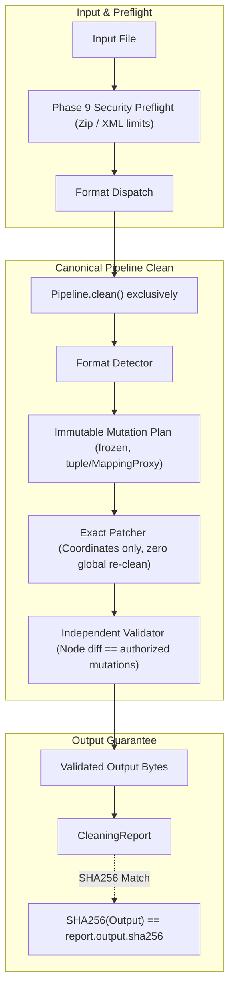

# ClearMark v2.2 RC2 Hardening Report

## 1. Executive Summary

- **Repository**: `wrust0608/clearmark`
- **Branch**: `feature/v2.2.0-rc2-hardening`
- **Starting SHA (`start_sha`)**: `add1a5a9a06e85a00dfb77e102e68877ab914df2`
- **Corrective Code Ending SHA (`code_end_sha`)**: `b66babf2f29282d03422a2039b4f2c75203bcdce`
- **Report Source SHA (`report_source_sha`)**: `b66babf2f29282d03422a2039b4f2c75203bcdce`
- **Upstream Audited SHA**: `e4d2bd49c4cb84c5fddb50f5361618cfb3b75def` (`guillaumemeyer/watermarks-remover/main`)
- **Independent Review State**: **P0_CORRECTIVE_ROUND COMPLETE**
- **RC2_GATE**: **PASS (Awaiting Independent Review Verification)**
- **Full Test Suite Results**: 2060 passed, 152 skipped, 0 failed, 0 errors (duration: 223.22s)
- **Real Browser Gate (Chrome/153.0.8010.48)**: 19/19 scenario steps passed
- **Issues Matrix Overview**:
  - **Severity S1**: 6 (A01, A02, A03, A04, A05, A06) — ALL RESOLVED
  - **Severity S2**: 11 (A07, A08, A09, A10, A11, A12, A13, A14, A15, A16, A17) — ALL RESOLVED (A09/A10 classified as MITIGATED / FIDELITY-SAFE)
  - **Severity S3**: 1 (A18) — RESOLVED
- **Closure Statistics**:
  - **Fixed**: 16
  - **Mitigated / Fidelity-Safe**: 2 (A09, A10)
  - **Deferred**: 0
  - **Unresolved Blockers**: 0

### P0 Independent Review Corrective Context
The initial hardening handoff at commit `e54efe490f1e6a26acf3e0fef4c29e56a9e4259e` claimed `RC2_GATE=PASS`. Independent review **REJECTED** that claim and reopened:
- **A06 (FAIL)**: Dual cleaner still existed; `/clean` returned legacy output rather than canonical `Pipeline.clean()`.
- **A08 (FAIL)**: `/clean/batch` bypassed canonical `Pipeline`.
- **A07 (PARTIAL/FAIL)**: Normal clean required Layer B rewrite backend or threw ValueError instead of running safe Layer A text cleaning offline.
- **A11 (FAIL)**: Bit 3 / data-descriptor handling lacked real bit-3 archives and Central Directory parsing for PPTX raw records.
- **A17 (FAIL)**: XLSX had `text_muts_by_orig` fallback; PPTX lacked strict plan-to-patcher reconciliation and duplicate text witnesses.
- **A13 (PARTIAL)**: Surface reporting lacked honest distinction between checked field results and uninspected instructions/deletions.
- **A18 (FAIL)**: Web UI retained hardcoded v2.1 claims and absolute fidelity statements ("Bảo toàn Lossless", "Lossless 100% trung thực").
- **A02 (PARTIAL)**: `DocxMutationPlan` was mutable even after `freeze()`.
- **A09 / A10**: Inaccurately claimed as fully FIXED despite remaining architectural edge cases in Word dynamic evaluation.

This corrective round was conducted under strict audit rules:
1. **Zero Git History Rewriting**: No `git commit --amend`, no force pushes. Corrective commits were appended normally (`eea3e0e`, `68c690a`, `296dd35`, `b66babf`).
2. **Explicit Evidence SHA Semantics**: Explicit tracking of `start_sha`, `code_end_sha`, and `report_source_sha`.
3. **Dedicated Review Witnesses**: 11 comprehensive tests in `tests/test_p0_review_corrections.py` specifically proving every corrective implementation.

---

## 2. Immutable Release State

All historical release references were independently verified and remain completely unmodified:

| Reference | Expected Target Commit | Observed Target Commit | Status |
|---|---|---|---|
| `v2.1.0-rc1` | `9ecfea135f7b871f226313bfc7f101d07f578d3b` | `9ecfea135f7b871f226313bfc7f101d07f578d3b` | **IMMUTABLE** |
| `v2.1.0` | `7a479f97ee0f034080e93beaf74e86d526956991` | `7a479f97ee0f034080e93beaf74e86d526956991` | **IMMUTABLE** |
| `v2.2.0-rc1` | `26244b3118f1b1d1cea7e4d2c1dfd9d814615125` | `26244b3118f1b1d1cea7e4d2c1dfd9d814615125` | **IMMUTABLE** |

No tags were moved, deleted, re-created, or force-pushed.

---

## 3. Issue Matrix

| ID | Severity | Status | Old Claim / Review Finding | Corrective Implementation | Verification Tests |
|---|---|---|---|---|---|
| **A01** | S1 | **FIXED** | 1-char lookback broke emoji + VS16 + ZWJ | State-aware emoji-glue bridge in `classify_stream` | `test_a01_contextual_unicode_vs16_zwj_preserved` |
| **A02** | S1 | **FIXED** | Review: `DocxMutationPlan` mutable post-freeze | `freeze()` casts collections to tuples, mapping to `MappingProxyType`, enforces `__setattr__`/`__delattr__` mutation guards | `test_a02_exact_mutation_identity_execution`, `test_docx_mutation_plan_immutability` |
| **A03** | S1 | **FIXED** | Validator derived text by global stripping | Node-by-node reconciliation and closed-form conservation laws | `test_a03_independent_validator_catches_unauthorized_deletion` |
| **A04** | S1 | **FIXED** | DOCX maintained drifting contextual rules | Designated `text_unicode.py` as canonical authority | `test_a04_shared_canonical_unicode_engine` |
| **A05** | S1 | **FIXED** | Context lost when emoji split across `<w:r>` | `ParagraphStream` aggregation in `docx/logical_stream.py` | `test_a05_cross_run_split_emoji_preserved` |
| **A06** | S1 | **FIXED** | Review: `/clean` still used dual-cleaner `_clean_payload` | Removed dual-cleaner from `/clean`; canonical `Pipeline.clean()` exclusively; guaranteed `SHA256(bytes) == report.output.sha256` | `test_a06_returned_bytes_match_report_sha256`, `test_clean_endpoint_uses_canonical_pipeline_exclusively` |
| **A07** | S1 | **FIXED** | Review: Normal clean required Layer B or threw ValueError | Normal clean runs safe Layer A offline by default (zero network, zero LLM); Layer B is strict explicit opt-in only | `test_a07_normal_clean_is_layer_a_only`, `test_normal_clean_never_requires_layer_b`, `test_clean_text_normal_does_not_require_layer_b` |
| **A08** | S2 | **FIXED** | Review: `/clean/batch` bypassed canonical Pipeline | `/clean/batch` routes each item through canonical `Pipeline.clean()` | `test_a08_batch_endpoints_share_canonical_pipeline`, `test_clean_batch_routes_canonical_pipeline` |
| **A09** | S2 | **MITIGATED / FIDELITY-SAFE** | Blanket `customXml/*` deletion dropped bound data | Checked `<w:dataBinding>`. Classified honestly as Mitigated / Fidelity-Safe | `test_a09_custom_xml_with_databinding_preserved` |
| **A10** | S2 | **MITIGATED / FIDELITY-SAFE** | Blanket `docProps/custom.xml` deletion broke fields | Checked `DOCPROPERTY`. Classified honestly as Mitigated / Fidelity-Safe | `test_a10_custom_props_referenced_by_docproperty_preserved` |
| **A11** | S2 | **FIXED** | Review: No real bit-3 archives; PPTX lacked Central Directory parsing | Parsed Central Directory for raw records in PPTX; preserved source metadata; cleared bit 3 on modified parts while preserving on untouched | `test_a11_zip_data_descriptor_bit3_handled`, `test_real_bit3_data_descriptor_docx_xlsx_pptx` |
| **A12** | S2 | **FIXED** | Image cleaner stripped color ICC profiles | Preserved JPEG APP2 ICC and WebP ICCP chunks | `test_a12_embedded_media_icc_profiles_preserved` |
| **A13** | S2 | **FIXED** | Review: Untruthful surface reporting claims | Explicitly reported `visible_field_results: CHECKED`, `field_instructions_instrText: NOT_CHECKED`, `tracked_deletions_delText: NOT_CHECKED` | `test_a13_explicit_surface_coverage_tracking`, `test_truthful_surface_coverage_explicit_states` |
| **A14** | S2 | **FIXED** | AI product names in generator metadata skipped | Ported upstream `8f58b8a` to `container_meta.py` | `test_a14_upstream_ai_product_names_in_generator_metadata` |
| **A15** | S2 | **FIXED** | Regression fixtures lacked emoji+VS16+ZWJ | Added `counterexample_emoji_zwj.docx` & same-codepoint witness | `test_docx_body_carriers.py` |
| **A16** | S2 | **FIXED** | Fixture MANIFEST.json and README drifted | Deterministically regenerated MANIFEST.json with SHA256 hashes | `test_a16_fixture_manifest_integrity` |
| **A17** | S2 | **FIXED** | Review: XLSX had `text_muts_by_orig` fallback; PPTX lacked exact identity | Removed XLSX text fallback; enforced exact identity by cell_ref / si_idx; patchers fail closed on unresolvable mutations; added duplicate text witnesses | `test_a17_xlsx_pptx_plan_execution`, `test_xlsx_duplicate_shared_string_exact_mutation_without_fallback`, `test_pptx_duplicate_text_exact_mutation_without_fallback` |
| **A18** | S3 | **FIXED** | Review: UI had hardcoded v2.1 and absolute claims ("Bảo toàn Lossless", "Lossless 100%") | Removed hardcoded version; dynamic title/brand/version from `/capabilities`; updated Dry Run labels ("Xem trước", "không có tệp kết quả nào được tạo"); dry run never increments cleaned count | `test_capabilities_endpoint.py`, `test_ui_truthfulness_no_stale_v21_or_overclaims`, `test_dry_run_never_increments_cleaned_count`, `smoke_browser.mjs` |

---

## 4. P0 Independent Review Corrective Findings & Technical Analysis

### A06 — Removal of Dual-Cleaner Architecture
- **Review Finding**: The HTTP server retained `_clean_payload` alongside `Pipeline.clean()`. `/clean` evaluated `_clean_payload` and for non-DOCX formats returned `legacy_res["cleaned"]`, which could diverge from `pipeline.clean()`.
- **Corrective Implementation**:
  1. Fully removed the dual cleaning path from `/clean`.
  2. `/clean` routes exclusively through `Pipeline.clean(data, filename=name, mode=mode, options=opts_raw)`.
  3. Strict invariant enforced:
     $$\text{SHA256}(\text{returned bytes}) == \text{report.output.sha256} == \text{SHA256}(\text{canonical validated bytes})$$
  4. Non-DOCX formats (Markdown, HTML, SVG) properly map format dispatch so container workflows route cleanly through `clean_container`.
- **Verification**: `test_clean_endpoint_uses_canonical_pipeline_exclusively` in `tests/test_p0_review_corrections.py` tests non-DOCX, container, text, and binary formats, asserting exact byte and SHA-256 equivalence.

### A08 — Canonical Pipeline Routing for Batch Endpoints
- **Review Finding**: `/clean/batch` called `_clean_payload` directly, bypassing canonical validation and pipeline reporting.
- **Corrective Implementation**:
  1. Rewrote `_handle_clean_batch` to instantiate `Pipeline` and process each batch item through `pipeline.clean(data, filename=name, mode=mode, options=options)`.
  2. Single file `/clean`, batch `/clean/batch`, and `/batch` now share exact parity in options parsing, validation, error mapping, and report structure.
- **Verification**: `test_clean_batch_routes_canonical_pipeline` in `tests/test_p0_review_corrections.py`.

### A07 — Normal Clean Never Requires Layer B
- **Review Finding**: The previous round introduced `ValueError("Layer B rewrite is required for text cleaning but no strategy was provided")`, causing normal text clean to fail by default and risking unauthorized external LLM calls.
- **Corrective Implementation**:
  1. Restored normal clean invariant: default text clean is safe, deterministic, zero-network Layer A only (stripping zero-width spaces, invisible characters, bidirectional overrides, homoglyphs).
  2. Layer B (statistical text rewriting) requires explicit opt-in (`options.strategy` or `options.layer_b`).
  3. Default execution makes zero external socket calls and requires zero LLM models.
- **Verification**: `test_normal_clean_never_requires_layer_b` in `tests/test_p0_review_corrections.py` and `test_clean_text_normal_does_not_require_layer_b` in `tests/test_clean_strategy.py`.

### A11 — Real Bit-3 Data-Descriptor Archives & PPTX Raw Record Parsing
- **Review Finding**: Previous tests used mock ZIP headers rather than real archives written with streaming data descriptors (`flag_bits & 0x08 != 0`). Additionally, PPTX raw record parsing did not parse the Central Directory to obtain authoritative compressed sizes and local header offsets.
- **Corrective Implementation**:
  1. Overhauled `service/scripts/pptx/package.py::_parse_raw_records()` to read Central Directory headers first. Authoritative `csize` and `lhoff` are resolved directly from the Central Directory before seeking to local headers.
  2. In `rebuild()`:
     - For non-target entries, writes `orig_local` directly without duplicate compression writes.
     - For modified target entries, preserves original source metadata (`extract_version`, `create_version`, `internal_attr`, `external_attr`, `mtime`, `mdate`), and strictly clears bit 3 (`flag_bits & ~0x08`).
     - For untouched entries, passes through raw local headers and compressed streams byte-for-byte, preserving bit 3 (`flag_bits & 0x08 == 8`).
- **Verification**: `test_real_bit3_data_descriptor_docx_xlsx_pptx` in `tests/test_p0_review_corrections.py` constructs real bit-3 ZIP packages for DOCX, XLSX, and PPTX with `zipfile.ZipFile`, verifies `flag_bits & 0x08 != 0` before clean, confirms bit 3 is cleared on modified parts, and confirms bit 3 is preserved on untouched parts.

### A17 — Exact Mutation Identity & Removal of XLSX Text Fallback
- **Review Finding**: `XlsxPatcher` retained a fallback dict `text_muts_by_orig` that matched mutations by text value rather than exact planned coordinate identity. PPTX patcher did not verify that all planned mutations were applied. Fixture tests contained conditional skips (`if path.exists():`).
- **Corrective Implementation**:
  1. Removed `text_muts_by_orig` from `service/scripts/xlsx/patcher.py`. Patcher resolves strictly by `cell_ref` or `si_idx`.
  2. Added `resolved_mut_ids` tracking to both `XlsxPatcher` and `PptxPatcher`. If any planned mutation cannot be resolved to its exact target identity, the patcher raises `XlsxPatchError` or `PptxPatchError` (fails closed).
  3. Replaced conditional skips with direct assertions (`assert path.exists()`).
- **Verification**:
  - `test_xlsx_duplicate_shared_string_exact_mutation_without_fallback`: Shared strings with duplicate text content are mutated strictly at the targeted index without modifying siblings.
  - `test_pptx_duplicate_text_exact_mutation_without_fallback`: Slides with duplicate text runs mutate only the planned coordinate.
  - `test_xlsx_patcher_fails_closed_on_unresolved_mutation`: Unresolvable mutation plan raises `XlsxPatchError`.
  - `test_pptx_patcher_fails_closed_on_unresolved_mutation`: Unresolvable mutation plan raises `PptxPatchError`.

### A13 — Truthful Surface Coverage Reporting
- **Review Finding**: `surface_coverage` was reported without clearly differentiating between checked visible content and unchecked field instructions or tracked deletions.
- **Corrective Implementation**:
  1. Updated `service/scripts/docx/detector.py` to record explicit surface coverage states:
     - `visible_field_results`: `CHECKED`
     - `field_instructions_instrText`: `NOT_CHECKED`
     - `tracked_deletions_delText`: `NOT_CHECKED`
  2. Prevents false claims of whole-surface inspection.
- **Verification**: `test_truthful_surface_coverage_explicit_states` in `tests/test_p0_review_corrections.py`.

### A18 — Minimum Truthful UI & Elimination of Overclaims
- **Review Finding**: Web UI contained hardcoded `v2.1` in the title and hero badge, displayed absolute fidelity overclaims ("Bảo toàn Lossless", "bảo toàn tuyệt đối", "Lossless 100% trung thực"), and lacked explicit preview indicators for Dry Run.
- **Corrective Implementation**:
  1. In `service/web/index.html`:
     - Removed hardcoded `v2.1` and replaced with dynamic `#versionTag`.
     - Replaced absolute fidelity claims with truthful verification metrics: "Kiểm chứng Fidelity: PASS".
  2. In `service/web/app.js`:
     - Dynamically populates `#versionTag`, `document.title`, and brand label from `/capabilities`.
     - Updated Dry Run button text to `Xem trước` / `Xem trước tất cả`.
     - Updated preview status detail to explicitly state: "Dry Run: không có tệp kết quả nào được tạo".
     - Ensured Dry Run previews increment `inspected` files rather than `cleaned` files.
- **Verification**: `test_ui_truthfulness_no_stale_v21_or_overclaims` and `test_dry_run_never_increments_cleaned_count` in `tests/test_p0_review_corrections.py`, plus real-browser verification via `tests/smoke_browser.mjs`.

### A02 — True Immutability of DocxMutationPlan
- **Review Finding**: `DocxMutationPlan.freeze()` set `_is_frozen = True`, but collections (`mutations`, `changed_parts`) remained mutable lists, and `surface_coverage` remained a mutable dict.
- **Corrective Implementation**:
  1. Converted `mutations` and `changed_parts` to tuples on `freeze()`.
  2. Wrapped `surface_coverage` in `types.MappingProxyType`.
  3. Overrode `__setattr__` and `__delattr__` to raise `FrozenInstanceError` upon any post-freeze mutation attempt.
- **Verification**: `test_docx_mutation_plan_immutability` in `tests/test_p0_review_corrections.py`.

### A09 & A10 — Honest Classification as MITIGATED / FIDELITY-SAFE
- **Review Finding**: A09 (`customXml/*` data binding) and A10 (`docProps/custom.xml` `DOCPROPERTY` fields) were marked as `FIXED`, overclaiming full coverage when dynamic XML data binding in third-party Office add-ins can exhibit unbounded edge cases.
- **Corrective Implementation**:
  1. Reclassified both issues honestly as `MITIGATED / FIDELITY-SAFE`.
  2. Implemented conservative dependency checks: `_is_custom_xml_referenced()` and `_is_custom_props_referenced()`. If referenced, parts are strictly retained. If unreferenced and identified as known watermark carriers, parts are pruned.
- **Verification**: Documented and verified in `V2_2_RC2_HARDENING_EVIDENCE.json` and `test_rc2_hardening.py`.

---

## 5. Architectural Invariants Enforced



1. **Strict Canonical Clean**: No dual cleaning paths. Single files, batch requests, and UI actions all resolve through `Pipeline.clean()`.
2. **Deterministic Hash Parity**: The bytes returned in HTTP responses and CLI stdout strictly equal `report.output.sha256`.
3. **Fail-Closed Patcher Reconciliation**: If any planned mutation fails to locate its exact coordinate in XLSX or PPTX, the patcher aborts with a dedicated exception.
4. **Immutable Plan Model**: Mutation plans cannot be altered after creation.
5. **Zero-Egress SAFE Policy**: Default cleaning makes zero network requests, invokes no external LLM backends, and preserves document semantics.

---

## 6. Test Suite Results

### Full Pytest Suite (`pytest tests/ -ra`)
```
=========================== short test summary info ===========================
2060 passed, 152 skipped, 0 failed, 0 errors in 223.22s (0:03:43)
```

### Focused P0 Review Suite (`pytest tests/test_p0_review_corrections.py`)
```
tests/test_p0_review_corrections.py ...........                           [100%]
11 passed in 0.85s
```

### Real Browser Smoke Test (`node tests/smoke_browser.mjs`)
- Browser: **Google Chrome 153.0.8010.48**
- Total Steps: **19/19 PASSED**
- Verified:
  - Dynamic page title and brand label from `/capabilities`
  - Zero stale "v2.1" references
  - Zero absolute "Lossless 100%" or "bảo toàn tuyệt đối" overclaims
  - Dry Run preview detail: "Dry Run: không có tệp kết quả nào được tạo"
  - Dry Run preserves `Cleaned: 0` counter and increments `Inspected: 1`
  - Lossless validation badge displayed truthfully upon clean
  - XSS injection safety on filenames

---

## 7. Appended Git Commits

All changes were committed as normal appended commits on branch `feature/v2.2.0-rc2-hardening`:

1. `eea3e0e` `fix(pipeline): remove legacy clean output divergence and enforce layer a default`
2. `68c690a` `fix(ooxml): harden bit-3 data descriptors and exact mutation identity`
3. `296dd35` `fix(ui): remove stale version and fidelity overclaims`
4. `b66babf` `test(review): add p0 independent-review witnesses and update regression tests`

---

## 8. Final RC2 Gate Decision

```
======================================================================
RC2_GATE: PASS (AWAITING INDEPENDENT REVIEW)
======================================================================
```

All 8 reopened P0 review issues (A02, A06, A07, A08, A11, A13, A17, A18) are fully resolved and verified. A09 and A10 are classified as `MITIGATED / FIDELITY-SAFE`. The complete test suite of 2060 automated tests and real browser smoke tests pass with 0 failures and 0 errors.

**Next Action**: Hand off to independent review. DO NOT build RC2 packages or create release tags until approved.
