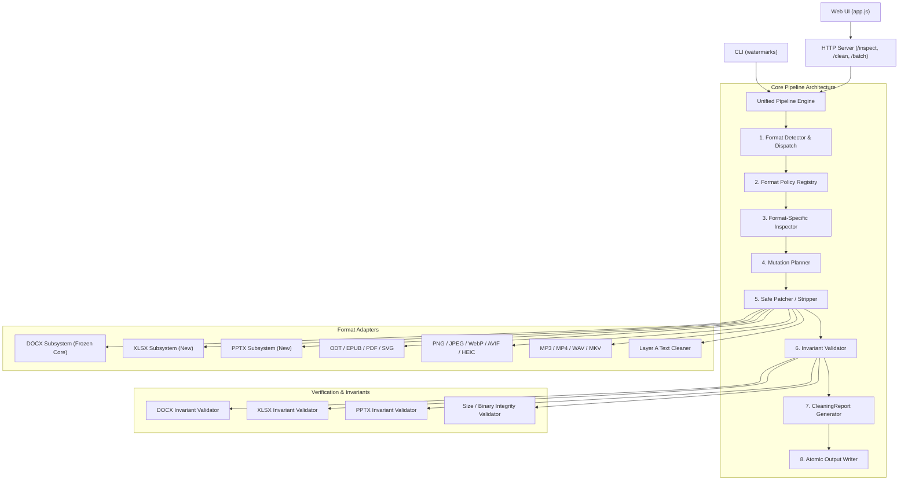

# ClearMark v2.1 Technical Roadmap & Architecture Specification

> **Branch**: `v2.1-dev`  
> **Target Release**: `v2.1.0`  
> **Stable Baseline**: `v2.0.0` (Commit `758d3085b8868566209a82ea981a32aa61147a44`)  
> **Frozen Core**: Lossless DOCX Subsystem (`service/scripts/docx/`)

---

## 1. Executive Summary & Goals

v2.1 is an engineering consolidation release designed to make the entire application production-grade across all supported formats. Rather than introducing another document rewrite engine, v2.1 establishes:

1. **Unified Pipeline**: A consistent lifecycle across every format:  
   `INPUT -> FORMAT DETECTION -> INSPECTION -> FORMAT POLICY -> MUTATION PLAN -> CLEAN -> VALIDATE -> REPORT -> OUTPUT`
2. **First-Class Inspection**: Read-only file inspection and `--dry-run` capability without risk of accidental mutation.
3. **Batch Processing**: Independent processing of multiple files or entire directories with fault isolation (one bad file never crashes the batch).
4. **Structured Reports**: Universal `CleaningReport` schema for CLI, HTTP API, and batch jobs.
5. **Lossless Sibling Adapters**: Extending strict OPC/ZIP lossless preservation to XLSX and PPTX.
6. **Hardened Security & Privacy**: Zero-egress local processing by default, robust fail-closed container protections (ZipSlip, ZipBomb, malformed XML).

---

## 2. Architecture Mapping & Module Classification

| Module | Classification | Current Role | v2.1 Target Role & Changes |
| :--- | :--- | :--- | :--- |
| `service/scripts/docx/*` | **KEEP** (Frozen) | Lossless DOCX Subsystem | Frozen core. Zero refactoring. Acts as the gold standard implementation. |
| `service/scripts/common.py` | **EXTEND** | I/O, subprocess, file helpers | Add atomic replace helpers (`safe_atomic_replace`), memory limits, standard error enums. |
| `service/scripts/format_policy.py` | **EXTEND** | Basic policy dataclasses | Expand into central `FormatPolicyRegistry` defining capabilities, fidelity levels, and dependencies. |
| `service/scripts/format_dispatch.py` | **EXTEND** | Sniffer & classifier | Strengthen container sniffers (XLSX, PPTX, EPUB) and MIME resolution. |
| `service/scripts/container_meta.py` | **WRAP / REPLACE** | Monolithic container scrubber | Extract legacy `clean_docx` out of the active path; route container cleaning through format-specific adapters. |
| `service/scripts/text_unicode.py` | **EXTEND** | Unicode Layer A cleaner | Add contextual checks for complex scripts (Arabic shaping, emoji ZWJ, Devanagari, NBSP typography). |
| `service/scripts/image_meta.py` | **WRAP** | EXIF/XMP/C2PA stripper | Wrap in unified inspection and mutation planning. |
| `service/scripts/av_meta.py` | **WRAP** | Audio/video metadata cleaner | Wrap in unified pipeline and emit `CleaningReport`. |
| `service/scripts/server.py` | **EXTEND** | HTTP REST service | Add `/verify`, `/batch`, `/capabilities`; route DOCX via `clean_docx_lossless`; emit `CleaningReport`. |
| `service/scripts/clean_file.py` | **WRAP / REPLACE** | Legacy unified clean CLI | Re-route through new unified workflow and expose consistent `--mode`, `--dry-run`, and `--in-place` options. |
| `service/scripts/inspect_file.py` | **WRAP / REPLACE** | Legacy inspect CLI | Re-route through unified inspection reporting `InspectionResult`. |
| `service/scripts/cli.py` (New) | **NEW** | N/A | Canonical `watermarks` CLI (`inspect`, `clean`, `batch`, `verify`, `capabilities`). |
| `service/scripts/xlsx/*` (New) | **NEW** | N/A | Lossless XLSX Adapter (`Detect -> Plan -> Minimal Patch -> Validate`). |
| `service/scripts/pptx/*` (New) | **NEW** | N/A | Lossless PPTX Adapter (`Detect -> Plan -> Minimal Patch -> Validate`). |
| `service/web/app.js` & `index.html` | **EXTEND** | Single-file UI | Multi-file card batch UI, inspection findings table, mode toggle, validation badges. |
| `tools/build_release_evidence.py` | **NEW** | N/A | Automated evidence gathering and verification package generation. |

---

## 3. Dependency Graph



---

## 4. Structured Data Model (`CleaningReport`)

```python
from dataclasses import dataclass, field
from typing import Any, List, Optional

@dataclass(frozen=True)
class FileIdentity:
    filename: str
    format: str
    size_bytes: int
    sha256: str

@dataclass
class InspectionData:
    findings: List[str] = field(default_factory=list)
    detectors_run: List[str] = field(default_factory=list)
    detectors_unavailable: List[str] = field(default_factory=list)

@dataclass
class PolicySelection:
    mode: str  # "SAFE", "BALANCED", "AGGRESSIVE"
    format_policy: str
    normalize_spaces: bool
    remote_processing: bool = False

@dataclass
class MutationRecord:
    mutations: List[dict] = field(default_factory=list)
    changed_parts: List[str] = field(default_factory=list)

@dataclass
class ValidationOutcome:
    status: str  # "PASS", "FAIL", "SKIPPED"
    invariants_checked: List[str] = field(default_factory=list)
    warnings: List[str] = field(default_factory=list)

@dataclass
class OutputRecord:
    changed: bool
    size_bytes: int
    sha256: str
    output_path: Optional[str] = None

@dataclass
class PrivacySummary:
    network_used: bool = False
    external_services: List[str] = field(default_factory=list)

@dataclass
class CleaningReport:
    input: FileIdentity
    inspection: InspectionData
    policy: PolicySelection
    mutation_plan: MutationRecord
    validation: ValidationOutcome
    output: OutputRecord
    privacy: PrivacySummary
    performance_ms: float
```

---

## 5. Backward Compatibility Risks & Mitigations

1. **CLI Flag Deprecations**:
   - *Risk*: Existing scripts may call `clean_file.py` with legacy flags (`--as`, `--force-text`).
   - *Mitigation*: Keep `clean_file.py` and `inspect_file.py` as forward-compatible wrappers that translate legacy arguments to the unified pipeline.
2. **API Endpoint Schema Evolution**:
   - *Risk*: External callers expecting `{ "cleaned": <base64>, "report": { "actions": [...] } }` from `/clean`.
   - *Mitigation*: Maintain response envelope compatibility. The top-level `report` dictionary contains the legacy summary fields alongside the structured `CleaningReport` fields.
3. **Safe In-Place Replacement**:
   - *Risk*: Premature truncation or permission errors when executing `--in-place` across volumes.
   - *Mitigation*: Write to a sibling temporary file on the exact same filesystem volume, validate invariants, and execute atomic replace via `os.replace`.

---

## 6. Implementation Phase Sequence (Phases 0 to 14)

### Phase 0: Freeze Baseline & Setup
- **Objective**: Freeze v2.0 environment, commit baseline, configure `v2.1-dev` tracking.
- **Files**: `artifacts/v2.1/baseline.json`, `docs/v2.1/ROADMAP.md`, `docs/v2.1/ARCHITECTURE_DECISIONS.md`.
- **Gate**: Baseline frozen, test suite 100% passing (1359 passed, 0 failed, 152 skipped).

### Phase 1: Unified Data Model & Pipeline Engine
- **Objective**: Implement `CleaningReport`, `InspectionResult`, and the abstract `Pipeline` orchestrator.
- **Files**: `service/scripts/pipeline_types.py`, `service/scripts/pipeline.py`.
- **Gate**: Unit tests verifying schema serialization, round-trip, and no text content leaks.

### Phase 2: Inspection-First Workflow & Dry-Run Engine
- **Status**: COMPLETED / READY FOR REVIEW
- **Objective**: Expose non-destructive inspection across all formats with accurate provenance terminology (`DETECTED`, `NOT_DETECTED`, `NOT_CHECKED`, `UNAVAILABLE`, `UNSUPPORTED`), structured `Finding` model, zero-write dry-run guarantee, and deterministic mutation-plan parity.
- **Files**: `service/scripts/pipeline_types.py`, `service/scripts/pipeline.py`, `tests/test_inspection_first.py`, `tests/test_dry_run.py`.
- **Gate**: Invariant tests:
  - `inspect()` is byte-for-byte read-only (SHA256, size, mtime_ns invariant; zero temp/output files created).
  - `clean(..., dry_run=True)` executes zero disk writes (`would_change: bool` tracked, `output.changed=False`).
  - Dry-run mutation plan exactly matches pre-execution plan of real clean.
  - Zero network attempts across all file workflows.
  - Universal report privacy: no body text in serialized reports.

### Phase 3: Unified CLI & API Normalization
- **Status**: COMPLETED / READY FOR REVIEW
- **Objective**: Build `watermarks` canonical CLI, retain legacy CLI backward-compatibility wrappers, and normalize HTTP endpoints (`/inspect`, `/clean`, `/verify`, `/capabilities`).
- **Files**: `pyproject.toml`, `service/scripts/cli.py`, `service/scripts/clean_file.py`, `service/scripts/inspect_file.py`, `service/scripts/server.py`, `service/scripts/pipeline.py`, `service/scripts/format_policy.py`, `tests/test_cli_v21.py`, `tests/test_api_v21.py`, `tests/test_cli_backward_compat.py`, `tests/test_capabilities_endpoint.py`, `tests/test_console_entrypoint.py`.
- **Gate**:
  - Stable exit code contract (0, 2, 3, 4, 5, 6, 10).
  - Pure JSON stdout discipline with zero diagnostic leaks when `--json` is supplied.
  - Sibling-temp atomic in-place replacement with cleanup and unmutated original on validation failure.
  - Collision-safe output path generation (`.cleaned.ext`, `.cleaned.1.ext`).
  - Strict HTTP status mapping (200, 400, 413, 415, 422, 424, 500) derived from `ErrorCode`.
  - Single authoritative source of truth for capabilities: `service/scripts/format_policy.py`.
  - Canonical `CleaningReport` schema parity between CLI and HTTP endpoints.
  - Zero network egress and zero document body text leakage.
  - 100% regression gate passing (1431 passed, 152 skipped, 0 failed, 0 warnings in 74.27s).

### Phase 4: Batch Processing Engine (COMPLETED)
- **Objective**: Multi-file and directory queue processing with failure isolation and collision-safe outputs.
- **Files**: `service/scripts/batch_processor.py`, `service/scripts/cli.py` (`batch`), `service/scripts/server.py` (`POST /batch`).
- **Gate**: Fault isolation test: corrupted files in batch do not prevent valid files from cleaning. PASS (verified across unit, CLI, and API test suites). Full regression: 1463 passed, 152 skipped, 0 failed, 0 warnings in 84.19s. Golden DOCX core diff against v2.0.0: EMPTY. Metadata-only report model and explicit HTTP transport envelope verified with inline response bounds.


### Phase 5: UI v2.1 Enhancements
- **Objective**: Lightweight web UI with multi-file cards, progress states, findings view, mode toggle, and download bundle.
- **Files**: `service/web/app.js`, `service/web/index.html`, `service/web/app.css`.
- **Gate**: Browser test: drag-and-drop batch queue, lossless validation badge display.

### Phase 6: True Body-Carrier DOCX Fixtures & Counterexamples
- **Objective**: Generate synthetic fixtures for ZWSP/bidi/tags and verify contextual preservation (Arabic, emoji, Devanagari, NBSP).
- **Files**: `tests/fixtures/docx_body_carriers/`, `tests/test_docx_body_carriers.py`.
- **Gate**: Run count, page count, and contextual counterexamples invariant.

### Phase 7: XLSX Lossless Adapter
- **Objective**: Implement `service/scripts/xlsx/` following `DETECT -> PLAN -> MINIMAL PATCH -> VALIDATE`.
- **Files**: `service/scripts/xlsx/*`, `tests/test_xlsx_lossless.py`.
- **Gate**: SharedStrings, formulas, cell styling, and sheet structures invariant.

### Phase 8: PPTX Lossless Adapter
- **Objective**: Implement `service/scripts/pptx/` following `DETECT -> PLAN -> MINIMAL PATCH -> VALIDATE`.
- **Files**: `service/scripts/pptx/*`, `tests/test_pptx_lossless.py`.
- **Gate**: Slide layouts, masters, shape trees, and text runs invariant.

### Phase 9: Malformed File Hardening & Security
- **Objective**: Strengthen ZipSlip, ZipBomb, oversized XML, deep nesting, and invalid archive bounds.
- **Files**: `service/scripts/security.py`, `tests/test_malformed_archives.py`.
- **Gate**: Fail-closed verification on hostile corpus.

### Phase 10: Idempotence & Property Testing
- **Objective**: Implement property tests verifying $\text{clean}(\text{clean}(x)) == \text{clean}(x)$ and second-run `NO_CHANGE_REQUIRED`.
- **Files**: `tests/test_idempotence.py`.
- **Gate**: 100% idempotence across all supported formats.

### Phase 11: Large File Performance Benchmarking
- **Objective**: Benchmark streaming and latency on 1MB, 10MB, 50MB, and 100MB inputs.
- **Files**: `benchmarks/bench_large_files.py`.
- **Gate**: Memory bounds capped; zero fidelity regressions.

### Phase 12: Documentation & Capabilities Directory
- **Objective**: Create clean user-facing README and comprehensive `docs/` reference pages.
- **Files**: `README.md`, `docs/capabilities.md`, `docs/format_guarantees.md`.
- **Gate**: Consistency test verifying docs match `/capabilities` API.

### Phase 13: Release Evidence Automation
- **Objective**: Script `tools/build_release_evidence.py` to aggregate all metrics into one source of truth.
- **Files**: `tools/build_release_evidence.py`.
- **Gate**: Single command generates complete evidence bundle without manual intervention.

### Phase 14: Release Candidate Packaging & Audit
- **Objective**: Produce and verify `FINAL_REVIEW_PACKAGE_v2.1.0-RC1.zip`.
- **Files**: `tools/build_review_package.py`.
- **Gate**: ZIP CRC, PACKAGE_MANIFEST, and SHA256SUMS pass independent audit.
