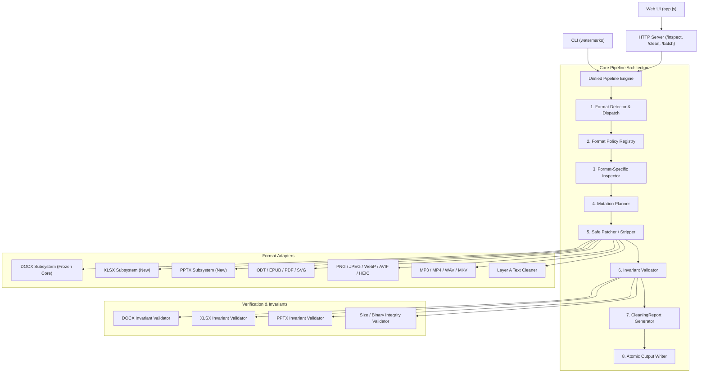

# ClearMark v2.1 Technical Roadmap & Architecture Specification

> **Branch**: `v2.1-dev`  
> **Target Release**: `v2.1.0`  
> **Stable Baseline**: `v2.0.0` (Commit `758d3085b8868566209a82ea981a32aa61147a44`)  
> **Frozen Core**: Lossless DOCX Subsystem (`service/scripts/docx/`)

---

## 1. Executive Summary & Goals

v2.1 is an engineering consolidation release designed to make the entire application production-grade across all supported formats. Rather than introducing another document rewrite engine, v2.1 establishes:

1. **Unified Pipeline**: A consistent lifecycle across every format:  
   `INPUT -> FORMAT DETECTION -> INSPECTION -> FORMAT POLICY -> MUTATION PLAN -> CLEAN -> VALIDATE -> REPORT -> OUTPUT`
2. **First-Class Inspection**: Read-only file inspection and `--dry-run` capability without risk of accidental mutation.
3. **Batch Processing**: Independent processing of multiple files or entire directories with fault isolation (one bad file never crashes the batch).
4. **Structured Reports**: Universal `CleaningReport` schema for CLI, HTTP API, and batch jobs.
5. **Lossless Sibling Adapters**: Extending strict OPC/ZIP lossless preservation to XLSX and PPTX.
6. **Hardened Security & Privacy**: Zero-egress local processing by default, robust fail-closed container protections (ZipSlip, ZipBomb, malformed XML).

---

## 2. Architecture Mapping & Module Classification

| Module | Classification | Current Role | v2.1 Target Role & Changes |
| :--- | :--- | :--- | :--- |
| `service/scripts/docx/*` | **KEEP** (Frozen) | Lossless DOCX Subsystem | Frozen core. Zero refactoring. Acts as the gold standard implementation. |
| `service/scripts/common.py` | **EXTEND** | I/O, subprocess, file helpers | Add atomic replace helpers (`safe_atomic_replace`), memory limits, standard error enums. |
| `service/scripts/format_policy.py` | **EXTEND** | Basic policy dataclasses | Expand into central `FormatPolicyRegistry` defining capabilities, fidelity levels, and dependencies. |
| `service/scripts/format_dispatch.py` | **EXTEND** | Sniffer & classifier | Strengthen container sniffers (XLSX, PPTX, EPUB) and MIME resolution. |
| `service/scripts/container_meta.py` | **WRAP / REPLACE** | Monolithic container scrubber | Extract legacy `clean_docx` out of the active path; route container cleaning through format-specific adapters. |
| `service/scripts/text_unicode.py` | **EXTEND** | Unicode Layer A cleaner | Add contextual checks for complex scripts (Arabic shaping, emoji ZWJ, Devanagari, NBSP typography). |
| `service/scripts/image_meta.py` | **WRAP** | EXIF/XMP/C2PA stripper | Wrap in unified inspection and mutation planning. |
| `service/scripts/av_meta.py` | **WRAP** | Audio/video metadata cleaner | Wrap in unified pipeline and emit `CleaningReport`. |
| `service/scripts/server.py` | **EXTEND** | HTTP REST service | Add `/verify`, `/batch`, `/capabilities`; route DOCX via `clean_docx_lossless`; emit `CleaningReport`. |
| `service/scripts/clean_file.py` | **WRAP / REPLACE** | Legacy unified clean CLI | Re-route through new unified workflow and expose consistent `--mode`, `--dry-run`, and `--in-place` options. |
| `service/scripts/inspect_file.py` | **WRAP / REPLACE** | Legacy inspect CLI | Re-route through unified inspection reporting `InspectionResult`. |
| `service/scripts/cli.py` (New) | **NEW** | N/A | Canonical `watermarks` CLI (`inspect`, `clean`, `batch`, `verify`, `capabilities`). |
| `service/scripts/xlsx/*` (New) | **NEW** | N/A | Lossless XLSX Adapter (`Detect -> Plan -> Minimal Patch -> Validate`). |
| `service/scripts/pptx/*` (New) | **NEW** | N/A | Lossless PPTX Adapter (`Detect -> Plan -> Minimal Patch -> Validate`). |
| `service/web/app.js` & `index.html` | **EXTEND** | Single-file UI | Multi-file card batch UI, inspection findings table, mode toggle, validation badges. |
| `tools/build_release_evidence.py` | **NEW** | N/A | Automated evidence gathering and verification package generation. |

---

## 3. Dependency Graph



---

## 4. Structured Data Model (`CleaningReport`)

```python
from dataclasses import dataclass, field
from typing import Any, List, Optional

@dataclass(frozen=True)
class FileIdentity:
    filename: str
    format: str
    size_bytes: int
    sha256: str

@dataclass
class InspectionData:
    findings: List[str] = field(default_factory=list)
    detectors_run: List[str] = field(default_factory=list)
    detectors_unavailable: List[str] = field(default_factory=list)

@dataclass
class PolicySelection:
    mode: str  # "SAFE", "BALANCED", "AGGRESSIVE"
    format_policy: str
    normalize_spaces: bool
    remote_processing: bool = False

@dataclass
class MutationRecord:
    mutations: List[dict] = field(default_factory=list)
    changed_parts: List[str] = field(default_factory=list)

@dataclass
class ValidationOutcome:
    status: str  # "PASS", "FAIL", "SKIPPED"
    invariants_checked: List[str] = field(default_factory=list)
    warnings: List[str] = field(default_factory=list)

@dataclass
class OutputRecord:
    changed: bool
    size_bytes: int
    sha256: str
    output_path: Optional[str] = None

@dataclass
class PrivacySummary:
    network_used: bool = False
    external_services: List[str] = field(default_factory=list)

@dataclass
class CleaningReport:
    input: FileIdentity
    inspection: InspectionData
    policy: PolicySelection
    mutation_plan: MutationRecord
    validation: ValidationOutcome
    output: OutputRecord
    privacy: PrivacySummary
    performance_ms: float
```

---

## 5. Backward Compatibility Risks & Mitigations

1. **CLI Flag Deprecations**:
   - *Risk*: Existing scripts may call `clean_file.py` with legacy flags (`--as`, `--force-text`).
   - *Mitigation*: Keep `clean_file.py` and `inspect_file.py` as forward-compatible wrappers that translate legacy arguments to the unified pipeline.
2. **API Endpoint Schema Evolution**:
   - *Risk*: External callers expecting `{ "cleaned": <base64>, "report": { "actions": [...] } }` from `/clean`.
   - *Mitigation*: Maintain response envelope compatibility. The top-level `report` dictionary contains the legacy summary fields alongside the structured `CleaningReport` fields.
3. **Safe In-Place Replacement**:
   - *Risk*: Premature truncation or permission errors when executing `--in-place` across volumes.
   - *Mitigation*: Write to a sibling temporary file on the exact same filesystem volume, validate invariants, and execute atomic replace via `os.replace`.

---

## 6. Implementation Phase Sequence (Phases 0 to 14)

### Phase 0: Freeze Baseline & Setup
- **Objective**: Freeze v2.0 environment, commit baseline, configure `v2.1-dev` tracking.
- **Files**: `artifacts/v2.1/baseline.json`, `docs/v2.1/ROADMAP.md`, `docs/v2.1/ARCHITECTURE_DECISIONS.md`.
- **Gate**: Baseline frozen, test suite 100% passing (1359 passed, 0 failed, 152 skipped).

### Phase 1: Unified Data Model & Pipeline Engine
- **Objective**: Implement `CleaningReport`, `InspectionResult`, and the abstract `Pipeline` orchestrator.
- **Files**: `service/scripts/pipeline_types.py`, `service/scripts/pipeline.py`.
- **Gate**: Unit tests verifying schema serialization, round-trip, and no text content leaks.

### Phase 2: Inspection-First Workflow & Dry-Run Engine
- **Status**: COMPLETED / READY FOR REVIEW
- **Objective**: Expose non-destructive inspection across all formats with accurate provenance terminology (`DETECTED`, `NOT_DETECTED`, `NOT_CHECKED`, `UNAVAILABLE`, `UNSUPPORTED`), structured `Finding` model, zero-write dry-run guarantee, and deterministic mutation-plan parity.
- **Files**: `service/scripts/pipeline_types.py`, `service/scripts/pipeline.py`, `tests/test_inspection_first.py`, `tests/test_dry_run.py`.
- **Gate**: Invariant tests:
  - `inspect()` is byte-for-byte read-only (SHA256, size, mtime_ns invariant; zero temp/output files created).
  - `clean(..., dry_run=True)` executes zero disk writes (`would_change: bool` tracked, `output.changed=False`).
  - Dry-run mutation plan exactly matches pre-execution plan of real clean.
  - Zero network attempts across all file workflows.
  - Universal report privacy: no body text in serialized reports.

### Phase 3: Unified CLI & API Normalization
- **Status**: COMPLETED / READY FOR REVIEW
- **Objective**: Build `watermarks` canonical CLI, retain legacy CLI backward-compatibility wrappers, and normalize HTTP endpoints (`/inspect`, `/clean`, `/verify`, `/capabilities`).
- **Files**: `pyproject.toml`, `service/scripts/cli.py`, `service/scripts/clean_file.py`, `service/scripts/inspect_file.py`, `service/scripts/server.py`, `service/scripts/pipeline.py`, `service/scripts/format_policy.py`, `tests/test_cli_v21.py`, `tests/test_api_v21.py`, `tests/test_cli_backward_compat.py`, `tests/test_capabilities_endpoint.py`, `tests/test_console_entrypoint.py`.
- **Gate**:
  - Stable exit code contract (0, 2, 3, 4, 5, 6, 10).
  - Pure JSON stdout discipline with zero diagnostic leaks when `--json` is supplied.
  - Sibling-temp atomic in-place replacement with cleanup and unmutated original on validation failure.
  - Collision-safe output path generation (`.cleaned.ext`, `.cleaned.1.ext`).
  - Strict HTTP status mapping (200, 400, 413, 415, 422, 424, 500) derived from `ErrorCode`.
  - Single authoritative source of truth for capabilities: `service/scripts/format_policy.py`.
  - Canonical `CleaningReport` schema parity between CLI and HTTP endpoints.
  - Zero network egress and zero document body text leakage.
  - 100% regression gate passing (1431 passed, 152 skipped, 0 failed, 0 warnings in 74.27s).

### Phase 4: Batch Processing Engine (COMPLETED)
- **Objective**: Multi-file and directory queue processing with failure isolation and collision-safe outputs.
- **Files**: `service/scripts/batch_processor.py`, `service/scripts/cli.py` (`batch`), `service/scripts/server.py` (`POST /batch`), `tests/test_batch_contract_closure.py`, `docs/v2.1/PHASE4_CONTRACT_CLOSURE_REPORT.md`.
- **Gate**: PASS. Fault isolation verified across unit, CLI, and API test suites: one corrupted or unsupported item never aborts healthy siblings; mathematical summary reconciliation strictly enforced (`total == sum(terminal categories)`). Stable public CLI exit mapping evidence: `0` = SUCCESS (all cleaned or no change), `2` = UNSUPPORTED (all items unsupported format; code 2 is strictly reserved for the UNSUPPORTED family, never for limits/setup/zero inputs), `3` = VALIDATION_FAILED, `4` = INVALID_INPUT (invalid configuration, Policy B, or zero inputs discovered), `5` = DEPENDENCY_MISSING, `6` = LIMIT_EXCEEDED (batch MAX_FILES, batch MAX_TOTAL_BYTES, or item limit), `7` = BATCH_PARTIAL_FAILURE (additive Phase 4 code for mixed outcomes; BATCH_PARTIAL_SUCCESS retained as alias), `10` = INTERNAL_ERROR. Resource limits always exit 6. Zero inputs strictly exits 4. Batch dry-run zero persistent writes invariant enforced: nonexistent `--output-dir` and `--reports-dir` are never created, zero report files or temp files written to disk, and input files remain byte-for-byte and timestamp immutable (`sha256`, `size`, `mtime_ns`). Recursive self-ingestion prevention: nested output (`input_root/generated/output`) and reports (`input_root/generated/reports`) directories excluded from discovery via canonical `_is_subpath_or_equal` with in-place `os.walk` pruning (`dirs[:] = [...]`). Rerun stability verified: re-running the exact same recursive batch command on the live tree never ingests previously generated `.cleaned.*` files or reports, preventing multiplicative artifact growth. Explicit Policy B rejection: configuring `--output-dir` or `--reports-dir` identical to input root is rejected with `INVALID_INPUT` (ExitCode 4). Symlink and junction/reparse-point traversal safety enforced (`_is_link_or_junction`). Windows case-insensitive path canonicalization prevents exclusion bypass. Legitimate user files with 'cleaned' in basename preserved. Report privacy (body sentinel excluded from JSON/reports) and zero network socket egress verified. Production defect fix commits: `dfa948da73f5e000eb564f35415968242e338845` (`fix(batch): enforce Phase 4 batch contract invariants`) and `2e1fa3b3161626b6cae7d2a143311fa1b480d7ac` (`fix(batch): preserve canonical CLI exit namespace`). Canonical Phase 4 evidence/docs closure: `1fb5cba5ef243021bf53ef4f1498aedf76ccfa16` (historical pre-amend commit: `3370fcc7b0ef0002c30748d410293e32cd790dd0`). Historical Phase 4 baseline full regression: 1463 passed, 152 skipped in 84.19s. Final focused closure: 23/23 passed (`tests/test_batch_contract_closure.py`). DOCX frozen core diff against v2.0.0: EMPTY. Golden DOCX and Candidate DOCX hashes verified. Canonical pre-closure full regression: 1912 passed, 152 skipped in 263.40s; Canonical post-contract-closure regression: 1935 passed, 152 skipped, 0 failed, 0 warnings in 123.70s. Phase 12: NOT STARTED.


### Phase 5: UI v2.1 Enhancements (COMPLETED)
- **Objective**: Lightweight web UI with multi-file cards, progress states, findings view, mode toggle, and download bundle.
- **Files**: `service/web/app.js`, `service/web/index.html`, `service/web/app.css`, `service/scripts/server.py`, `tests/test_ui_contract.py`, `tests/test_web_app.mjs`, `tests/smoke_browser.mjs`.
- **Gate**: PASS. Capabilities-driven initialization, multi-file queue with deterministic states, inspection-first findings drawer, SAFE mode default, dynamic capability-aware mode disabling, stale mode protection, dry-run simulation, partial batch failure isolation, honest terminology (ADR-003), DOCX lossless validation badge displayed only on runtime PASS, safe download name sanitization, Object URL lifecycle management, and XSS safety verified. Real browser smoke gate passed 19/19 steps on Google Chrome 153.0.8010.48. Full pytest regression: 1481 passed, 152 skipped, 0 failed, 0 warnings in 89.49s. DOCX frozen core diff against v2.0.0: EMPTY. Golden DOCX and Candidate DOCX hashes verified.

### Phase 6: True Body-Carrier DOCX Fixtures & Contextual Preservation (COMPLETED)
- **Objective**: Generate synthetic fixtures for ZWSP/bidi/tags and verify contextual preservation (Arabic, emoji, Devanagari, NBSP).
- **Files**: `docs/v2.1/PHASE6_CARRIER_RULE_MATRIX.md`, `docs/v2.1/PHASE6_DOCX_BODY_CARRIER_REPORT.md`, `tests/fixtures/docx_body_carriers/build_fixtures.py`, `tests/fixtures/docx_body_carriers/MANIFEST.json`, `tests/test_docx_body_carriers.py`.
- **Gate**: PASS. Deterministic 12-fixture corpus with cryptographic SHA256 provenance generated without external dependencies. Zero false positives and zero false negatives against declared expectations. Invariant run count (`run_count_before == run_count_after`), paragraph count, table count, cell count, manual page breaks (`<w:br w:type="page"/>`), and tabs across all positive fixtures. Byte-for-byte preservation of legitimate contextual Unicode: emoji ZWJ sequences (family, profession, gendered), Arabic/Persian orthographic joiners, Devanagari shaping conjuncts, protected typographic spaces (U+00A0 NBSP, U+202F NNBSP), and NFC/NFD distinct representations. Non-target OPC package members byte-for-byte identical. Pipeline inspection, dry-run parity, report privacy, zero network egress, and second-pass cleaning idempotence verified. Canonical v2.0 Golden regression passed. DOCX frozen core diff against v2.0.0: EMPTY. Full pytest regression (initial): 1525 passed, 152 skipped, 0 failed, 0 warnings in 71.48s; Phase 6 evidence-closure canonical result: 1530 passed, 152 skipped, 0 failed, 0 warnings in 96.52s.

### Phase 7: XLSX Lossless Adapter (COMPLETED)
- **Objective**: Implement `service/scripts/xlsx/` following `DETECT -> PLAN -> MINIMAL PATCH -> VALIDATE`.
- **Files**: `service/scripts/xlsx/*`, `docs/v2.1/PHASE7_XLSX_RULE_MATRIX.md`, `docs/v2.1/PHASE7_XLSX_LOSSLESS_REPORT.md`, `tests/fixtures/xlsx_lossless/build_fixtures.py`, `tests/fixtures/xlsx_lossless/MANIFEST.json`, `tests/test_xlsx_lossless.py`.
- **Gate**: PASS. Shared strings never re-indexed/deduplicated; rich text runs preserved; formula expressions `<f>`, attributes, and cached values `<v>` 100% invariant; styles preserved byte-identical; strict raw OPC non-target pass-through and binary record identity; legitimate custom properties and custom XML preserved raw by default; media preserved raw; canonical two-file verify contract implemented across CLI and HTTP; empty-plan zero-copy identity; fail-closed validation safety; report privacy; zero network. Focused Phase 7 test suite: 39 passed, 0 failed in 4.14s. Cross-format regression: 85 passed, 0 failed in 11.31s. 14 deterministic fixtures in corpus. DOCX frozen core diff against v2.0.0: EMPTY. Historical pre-safety-closure full regression: 1557 passed, 152 skipped, 0 failed, 0 warnings in 97.52s; Canonical post-safety-closure full regression: 1569 passed, 152 skipped, 0 failed, 0 warnings in 97.39s.

### Phase 8: PPTX Lossless Adapter (COMPLETED)
- **Objective**: Implement `service/scripts/pptx/` following `DETECT -> PLAN -> MINIMAL PATCH -> VALIDATE`.
- **Files**: `service/scripts/pptx/*`, `docs/v2.1/PHASE8_PPTX_RULE_MATRIX.md`, `docs/v2.1/PHASE8_PPTX_LOSSLESS_REPORT.md`, `tests/fixtures/pptx_lossless/build_fixtures.py`, `tests/fixtures/pptx_lossless/MANIFEST.json`, `tests/test_pptx_lossless.py`.
- **Gate**: PASS. Slide layouts, masters, themes, and notes preserved raw / truthful NOT_CHECKED. Shape tree ordering, shape IDs, and shape 2D geometry invariant. Paragraph count, run count, run properties, and manual line breaks strictly invariant. Field text `<a:fld>` and group shapes `<p:grpSp>` preserved as NOT_CHECKED. Table structures and cell formatting preserved. Media parts preserved raw (local header, compressed stream, and CRC identical). Strict raw OPC non-target binary pass-through. Empty-plan zero-copy identity (`cleaned_bytes is orig_bytes`). Fail-closed safety on corrupted invariant witnesses, macro presentations, and digitally signed presentations. CLI and HTTP two-file verify contracts implemented. Headless LibreOffice render parity verified. Report privacy and zero-network isolation enforced. Implementation commit: `17bb830e085100416d1ee59dcd266a0456156777`. Relationship/security evidence-closure commit: `edea43543befbf685f91ef69407242d82e0a7bfe`. Focused Phase 8 suite: 46/46 passed in 3.14s. 17 deterministic fixtures in corpus. DOCX frozen core diff against v2.0.0: EMPTY. Canonical post-audit full regression: 1615 passed, 152 skipped, 0 failed, 0 warnings in 82.77s (historical pre-audit: 1610 passed in 81.65s).

### Phase 9: Malformed File Hardening & Security Preflight (COMPLETED)
- **Objective**: Build a unified container-level and XML-level security preflight layer (`service/scripts/security.py`) enforcing REJECT BEFORE MUTATION across ZipSlip, ZipBomb amplification, oversized archives, excessive member counts, corrupted/truncated headers, duplicate members, symlinks, encrypted members, unsupported compression, DTD/XXE attacks, deep XML nesting, element limits, and malformed XML.
- **Gate**: PASS. Central security preflight implemented in `service/scripts/security.py`. Frozen DOCX core byte-for-byte identical to v2.0.0. All 38 threats in Threat Matrix verified against deterministic synthetic hostile fixtures with 1-to-1 executable tests. ZipSlip rejected across relative, absolute Unix, Windows drive, UNC, and backslash paths. Duplicate entries, symlinks, encrypted entries, and unsupported compression rejected fail-closed. Explicit fail-closed policy for ZIP64 (records, locators, sentinels, and extra field ID 0x0001) and multi-disk archives. Resource bounds enforced for member count, member uncompressed size, total uncompressed size, and compression ratio via streaming chunked decompression with CRC, ratio floor, and EOF validation. Bit-3 signed (16 B) and unsigned (12 B) data descriptors validated against Central Directory; descriptor-aware physical member range calculation prevents overlaps. XML security enforces part size bounds, expat-based non-recursive streaming depth and element count limits with O(1) memory overhead, encoding probes (UTF-8, UTF-8 BOM, UTF-16 LE/BE, ISO-8859-1), and proactive DOCTYPE/ENTITY/XXE rejection with 0 network calls and 0 disk writes verified. Fail-closed on malformed XML. Full integration across Pipeline (`inspect`, `clean` dry-run and real), CLI (`inspect`, `clean`, `batch`, `verify`), and HTTP (`/inspect`, `/clean`, `/verify`, `/batch`). Two-file verify contract preflights both original and candidate independently with clean separation between preflight errors (Exit 4 / HTTP 400, Exit 6 / HTTP 413) and fidelity failures (Exit 3 / HTTP 422). Batch fault isolation preserves sibling files. Metadata-only error reporting with ANSI sanitization. Implementation commit: `73a5c24b47842c8e68e1a1fc40622db70eec3c0d`. Evidence closure commit: `408b3e606e3949220a8e221c014378ac51a1a4c7`. Final descriptor closure commit: `73783182300e4b4a9e57758b2a1ae4a99a9cf236`. Focused Phase 9 suite: 141/141 passed in 1.30s. Focused format regression: 135/135 passed in 14.18s (49 DOCX, 40 XLSX, 46 PPTX). Contract regression: 86/86 passed in 11.32s. Canonical final post-Phase9 full regression: 1759 passed, 152 skipped, 0 failed, 0 warnings in 103.82s (pre-Phase9 baseline: 1615 passed, 152 skipped in 82.77s). DOCX frozen core diff against v2.0.0: EMPTY. Golden DOCX and Candidate DOCX hashes verified. Phase 10: NOT STARTED.

### Phase 10: Idempotence & Property Testing (COMPLETED)
- **Objective**: Implement property tests verifying $\text{clean}(\text{clean}(x)) == \text{clean}(x)$, byte fixed point, SHA256 invariant, empty second-pass mutation plan, and second-run `NO_CHANGE_REQUIRED`.
- **Files**: `service/scripts/pipeline.py`, `service/scripts/server.py`, `tests/test_idempotence.py`, `tests/test_property_unicode.py`, `docs/v2.1/PHASE10_IDEMPOTENCE_REPORT.md`.
- **Gate**: PASS. Primary system property $C(C(x)) == C(x)$ verified as byte fixed point, SHA fixed point, and size fixed point across 100% of runtime-supported and available canonical cleaning formats (22/22 canonical policies, 16 aliases; PDF truthfully handled under Model B bounded fallback and excluded from denominator). Second pass status strictly NO_CHANGE_REQUIRED with changed=False, would_change=False, and empty mutation plan. Already-clean inputs return exact original bytes with 0 mutations. Seeded deterministic generative/property-style testing (`DeterministicUnicodePropertyGenerator`, seed 0xDEADBEEF, 100 bounded examples) verifies contextual Unicode preservation (emoji ZWJ, Arabic joiners, Devanagari conjuncts, NBSP/NNBSP, NFC/NFD) with 0 false positives and multi-carrier one-pass convergence. Mode independence (SAFE, BALANCED, AGGRESSIVE across 67 parameter executions) and option independence (normalize_spaces=False vs True) tested independently. Lossless OOXML invariants verified on DOCX (Phase 6 corpus, Golden v2.0, Candidate), XLSX (Phase 7 corpus), and PPTX (Phase 8 corpus) with 0 ZIP repacking drift. Security preflight compatibility confirmed on all first-pass outputs. Full integration convergence verified across Pipeline, CLI, HTTP API, BatchProcessor, Two-File Verify, and In-Place cleaning. Truthful handling of optional dependency missing (`ErrorCode.OPTIONAL_DEPENDENCY_MISSING`) for PDF when markers survive, and stable unsupported semantics (`ErrorCode.UNSUPPORTED_FORMAT`, CLI Exit 2, HTTP 415, 0 disk writes, 0 network). DOCX frozen core diff against v2.0.0: EMPTY. Golden DOCX and Candidate DOCX hashes verified. Production fixes: `pipeline.py` (idempotence invariant enforcement on clean containers, SVG/AV routing, uncleaned PDF dependency error mapping, inspection probe filtering) and `server.py` (truthful C2PA presence check post-cleaning, extension-aware 415 mapping for unsupported clean). Phase 10 implementation/test commit: `c13b02a0110a783d3fb8382bf11070ed41ef9799`. Capability/provenance closure commit: `15e856f0ead38d69ce2959e1d510ab55e6f1c9be`. Final contract closure commit: `4fc81aae8d1e389ad3f39a04f21db7c828236294`. Focused Phase 10 suite: 139/139 passed in 7.54s (132 idempotence + 7 property). Phase 9 security regression: 141/141 passed in 1.34s. Format regression: 135/135 passed in 14.43s (49 DOCX, 40 XLSX, 46 PPTX). Contract regression: 88/88 passed in 10.09s. Canonical final post-Phase10 full regression: 1900 passed, 152 skipped, 0 failed, 0 warnings in 121.09s (pre-Phase10 baseline: 1759 passed, 152 skipped in 103.82s). Phase 11: NOT STARTED.

### Phase 11: Large File Performance Benchmarking (COMPLETED)
- **Objective**: Benchmark streaming, latency, peak resident memory (parent and child process tree), throughput, and memory budgets across 1 MiB, 10 MiB, 50 MiB, and 100 MiB inputs without weakening security, fidelity, privacy, or idempotence.
- **Files**: `benchmarks/bench_large_files.py`, `tests/test_performance_harness.py`, `artifacts/v2.1/phase11_benchmark.json`, `docs/v2.1/PHASE11_PERFORMANCE_REPORT.md`.
- **Gate**: PASS. Audited runtime resource limits across top-level CLI (`common.MAX_INPUT_BYTES` 256 MiB), HTTP server (`server.MAX_INPUT_BYTES` 256 MiB, `server.MAX_BODY_BYTES` 384 MiB), batch engine (32 MiB per-file limit, 200 MiB aggregate), and security preflight (`SecurityLimits`: 64 MiB member uncompressed, 128 MiB total uncompressed, 32 MiB XML part). Verified 100 MiB target compatibility across CLI and API pipelines; oversized items in batch processor cleanly rejected with `PROCESSING_LIMIT_EXCEEDED` preserving fault isolation (10/10 valid 10 MiB items succeeded, 1/1 oversized 50 MiB item rejected). Multi-process resident memory sampling via `ProcessTreeMemorySampler` (5ms polling interval via psutil) proved capable of capturing subprocess trees via `test_process_tree_child_witness` (observed 65.39 MiB child RSS). Audit of canonical `Pipeline.clean()` call graph verified zero external processes spawned: audio cleaning routes to `av_meta.clean_av` / `_strip_wav` which operates 100% in-process on RIFF chunks without spawning `ffmpeg` or any child subprocess; WAV reclassified truthfully to `AUDIO_RIFF_IN_PROCESS` / `STREAMING_INPUT_FULL_OUTPUT` with memory guardrail $\le 96\text{ MiB} + 5.0 \times S$ (all PASS: 50M delta 150.0 MiB, 100M delta 300.0 MiB < 596.0 MiB limit). External process performance profile truthfully classified as NOT APPLICABLE TO CURRENT CANONICAL CLEAN PATHS (destructive audio/video purifiers are standalone service-endpoint transcoders, not canonical pipeline cleaners). Scaling profiles: 14 total; 13 full-grid (1, 10, 50, 100 MiB) + 1 partial-grid (`cli_txt_positive`: 1, 10 MiB only). Breadth smoke passed across 100% of available canonical policies (22/22 available policies benchmarked, 0 unhandled failures; PDF dependency-unavailable handled cleanly). Historical baseline had NO predeclared in-process RSS guardrail; post-measurement closure guardrails calibrated per architecture (`CLOSURE_GUARDRAILS`) verified across 50 and 100 MiB closure runs in `artifacts/v2.1/phase11_closure_guardrails.json` (all PASS). Focused ODT 50->100 MiB investigation verified 1.65× ratio across 5 repetitions (PASS $\le 3.0\times$). PNG 100 MiB semantic closure completed: diagnosed pseudo-random `cai:`/`c2ma` collision in 100 MiB `prNd` private chunk causing inadvertent chunk drop; fixed in `service/scripts/image_meta.py` (`70d2f9e0ebefddca34e626e632b07e8ebec9bf96`) to require verified C2PA carrier or JUMBF container header; verified via permanent regression test `test_png_private_chunk_accidental_marker_is_not_deleted`; regenerated apples-to-apples 1/10/50/100 MiB scaling metrics (50->100 time ratio 2.74×, output 104,857,556 B, delta 44 B, idempotence PASS); historical 0.99x / 67-byte profile preserved in `phase11_benchmark_historical.json`. Sequential memory leak probe (10x10 MiB runs) proved zero leak (-4096 bytes baseline drift, flat at 41.8 MiB). Large file idempotence and OOXML fidelity verified across representative 10/50/100 MiB positive workloads. Zero network egress and zero sensitive user data. DOCX frozen core diff against v2.0.0: EMPTY. Golden DOCX and Candidate DOCX hashes verified. Phase 11 Commit Provenance: Harness commit `6dfefb625d394116d60dd8686b2d9ead77b9419b`; Budget/sampler closure `7bba59fa4714a63852940abc550350b981be69a1`; Evidence/docs closure `841e6e18fbf79069d2a2333cfc8764049875f308`; PNG defect fix `70d2f9e0ebefddca34e626e632b07e8ebec9bf96`; Canonical execution-path/evidence closure: `6d2c24a4189e54c0e4d1803ebf2bdeac43a9d8f7`; Historical pre-amend hash: `115178a1c1e18107bc2b3f67d9175c06d2dea7c2`. Focused harness tests: 11/11 passed in 101.07s. Phase 9 security regression: 141/141 passed in 3.65s. Phase 10 idempotence regression: 139/139 passed in 12.62s. Format regression: 135/135 passed in 29.50s. Contract regression: 88/88 passed in 15.54s. Canonical final post-Phase11 full regression: 1912 passed, 152 skipped, 0 failed, 0 warnings in 263.40s. Phase 12: NOT STARTED.

### Phase 12: Documentation & Capabilities Directory (COMPLETED)
- **Objective**: Create clean user-facing README and comprehensive `docs/` reference pages derived from executable runtime truth.
- **Files**: `README.md`, `docs/capabilities.md`, `docs/format_guarantees.md`, `docs/v2.1/PHASE12_DOCUMENTATION_REPORT.md`, `tests/test_docs_capabilities_consistency.py`.
- **Gate**: PASS. Automated consistency test suite (`tests/test_docs_capabilities_consistency.py`: 17/17 passed in 0.25s) verified 100% parity between public documentation, `FormatPolicyRegistry.get_default()`, and HTTP `GET /capabilities`. Full canonical coverage: 23 canonical format policies, 37 total extensions, 14 extension aliases beyond canonical (16 non-identity extensions). Exact mode parity (`svg` safe-only; 22 multi-mode). Exact verify capability parity (`docx`, `xlsx`, `pptx` only). Exact dependency parity: 22 available policies, 1 dependency-sensitive policy (`pdf` under Model B bounded fallback requiring `ghostscript`, `qpdf`, `c2patool`). Deterministic resource limits verified against production constants (`common.MAX_INPUT_BYTES` 256 MiB, `common.MAX_STDIN_BYTES` 64 MiB, `server.MAX_BODY_BYTES` 384 MiB, `server.MAX_INPUT_BYTES` 256 MiB, `batch_processor.MAX_INPUT_BYTES` 32 MiB, `batch_processor.MAX_BATCH_TOTAL_BYTES` 200 MiB, `batch_processor.MAX_BATCH_FILES` 100, `server.MAX_BATCH_FILES` 50, `security.SecurityLimits` 64 MiB member, 128 MiB total, 100x ratio, 32 MiB XML part, 128 MiB XML total, 100 depth, 500,000 elements). Preflight error status parity verified: numeric resource ceilings map to `PROCESSING_LIMIT_EXCEEDED` (CLI Exit 6 / HTTP 413); unsupported features map to `UNSUPPORTED_ARCHIVE_FEATURE` (CLI Exit 4 / HTTP 422); malformed containers map to `INVALID_CONTAINER` (CLI Exit 4 / HTTP 400); validation failures map to `VALIDATION_FAILED` (CLI Exit 3 / HTTP 422). Contextual Unicode preservation verified: `U+200C`/`U+200D` are strictly preserved in legitimate contexts (emoji ZWJ, Arabic/Persian/Devanagari joiners) and never unconditionally stripped. Canonical audio/video execution verified: standard cleaning is 100% in-process via `clean_av()` with zero subprocesses and no `ffmpeg` across WAV, MP3, FLAC, MP4; `ffmpeg` and `audio_watermark_notch` reserved for standalone purifiers. XLSX shared-string invariants verified: shared-string indices and referring cell indices remain unchanged. CLI batch ceiling (100 files) and HTTP `/batch` request ceiling (50 files) truthfully distinguished. CLI exit codes verified against `ExitCode` enum and Phase 4 contract (0 SUCCESS, 2 UNSUPPORTED strictly reserved for format routing, 3 VALIDATION_FAILED, 4 INVALID_INPUT, 5 DEPENDENCY_MISSING, 6 LIMIT_EXCEEDED, 7 BATCH_PARTIAL_FAILURE with alias BATCH_PARTIAL_SUCCESS, 10 INTERNAL_ERROR). HTTP status codes verified against `error_code_to_http_status()` (200, 400, 413, 415, 422, 424, 500). Status terminology strictly distinguishes `NOT_CHECKED` from `NOT_DETECTED`; `NO_CHANGE_REQUIRED` truthfully scoped to supported checked surfaces. CLI command examples in README validated against actual parser arguments. 0 broken relative markdown links; 0 private host paths or usernames; 0 hyperbolic or unproven marketing claims. DOCX frozen core diff against v2.0.0: EMPTY. Golden DOCX (`c05ca5c1be3b020b75d5763cf22061879a255b3c4f57b0455ae562b54809f58d`) and Candidate DOCX (`7aa5549f6a0e0b78fa39245c0e79503b2cc9defd6cffbfa5c8a833072d430297`) hashes verified. Production source changes: NONE. Commit provenance: Documentation commit `c6a4b3afbc1d58e30d39202746449f089735bb3d`; Semantic truthfulness closure commit: `02cd1e75525ca0ce238e87413a96860d5dd14d10`. Canonical post-Phase 12 full regression: 1952 passed, 152 skipped, 0 failed, 0 warnings in 198.43s (pre-Phase 12 baseline: 1935 passed, 152 skipped in 123.70s). Phase 13: NOT STARTED.

### Phase 13: Release Evidence Automation (COMPLETED)
- **Objective**: Script `tools/build_release_evidence.py` to aggregate all metrics into one source of truth.
- **Files**: `tools/build_release_evidence.py`, `tests/test_release_evidence.py`, `docs/v2.1/PHASE13_RELEASE_EVIDENCE_REPORT.md`, `artifacts/v2.1/release_evidence/*`.
- **Gate**: PASS. Single command (`python tools/build_release_evidence.py --full`) generates, validates, and atomically publishes the complete ClearMark v2.1 release evidence bundle to `artifacts/v2.1/release_evidence/`. Clean-tree enforcement guaranteed (fails-closed on dirty tree unless `--allow-dirty`). Schema 1.0 JSON and human-readable Markdown summary emitted alongside modular JSON views (`TEST_RESULTS.json`, `CAPABILITIES.json`, `LIMITS.json`, `PROVENANCE.json`, `HASHES.json`, `MANIFEST.json`, `MANIFEST.sha256`). Capabilities derived from `FormatPolicyRegistry.get_default()` (23 policies, 37 extensions, 22 runtime-available, 1 dependency-sensitive PDF). Resource limits extracted from production constants. Public exit codes and HTTP status mappings validated with cross-contract semantic invariant checks. Frozen DOCX core diff against v2.0.0: EMPTY. Golden DOCX (`c05ca5c1be3b020b75d5763cf22061879a255b3c4f57b0455ae562b54809f58d`) and Candidate DOCX (`7aa5549f6a0e0b78fa39245c0e79503b2cc9defd6cffbfa5c8a833072d430297`) hashes verified. Privacy scrubbing and zero external network requests verified via unit tests (`tests/test_release_evidence.py`: 16/16 passed in 0.81s). Manifest verification: PASS (7 files, 0 mismatches, MANIFEST.sha256 verified). Deterministic rerun: PASS (Run 1 vs Run 2 identical across all deterministic keys). Production source changes: NONE. Commit provenance: Builder commit `53e65b6f3a7eb7ec882b453e1a6beaa53a2ef565`; Prior evidence closure commit: `e3cca1a7ad4bb1b12b23023e32bdf55959952549`; Builder suite improvement commit: `32e1a2c3afae7d6b738630787ce4d2f7b3640c56`. Canonical post-Phase 13 full regression: 1968 passed, 152 skipped, 0 failed, 0 warnings in 146.52s (pre-Phase 13 baseline: 1952 passed, 152 skipped in 198.43s). Canonical release status: `overall_status = PASS`, `release_ready = true`. Phase 14: COMPLETED.

### Phase 14: Release Candidate Packaging & Audit (COMPLETED)
- **Objective**: Build a deterministic, independently auditable release-candidate review ZIP from the canonical Phase 13 release-ready source state.
- **Files**: `tools/build_review_package.py`, `tests/test_review_package.py`, `docs/v2.1/PHASE14_RELEASE_CANDIDATE_REPORT.md`, `artifacts/v2.1/release_candidate/*`.
- **Gate**: PASS. Packaging builder commit `02e86b334188b200b3967d7a8d5e1dc862e31ea2`; Audit closure commit `89e34d113182a04ab48005796d45f9714d69eb7e`; Source commit `32e1a2c3afae7d6b738630787ce4d2f7b3640c56`; Evidence closure commit `4321724ceadb3d699c826bb1115c6189c5f620ad`. Package `FINAL_REVIEW_PACKAGE_v2.1.0-RC1.zip` (2,043,966 bytes, 527 members, 525 payload files, 4,979,482 payload bytes) bound strictly to Git object database (0 working tree files). Source tree digest `bfdf802606ea645af299578c43f269bb5c3665835836b07bba12c493f55f6910` verified. Package SHA256 `33616f74730a0e026efa751d1fb5d86d5f310e2d66f6de3d34afec3635d716d9`. Byte reproducibility: Build A SHA256 == Build B SHA256 (IDENTICAL). Non-recursive 3-tier hash architecture: `PACKAGE_MANIFEST.json` inventories 525 payload files only; `SHA256SUMS` inventories 525 payload files plus `PACKAGE_MANIFEST.json`; `.zip.sha256` hashes complete archive. Single root `ClearMark-v2.1.0-RC1/`. 0 ZipSlip / traversal, 0 backslashes, 0 leading slashes, 0 drive prefixes. 0 duplicate filenames, 0 case collisions, 0 Windows reserved device names, 0 symlinks (120000), 0 gitlinks (160000), 0 encrypted entries. Standard non-ZIP64 archive (`allowZip64=False`). Fixed timestamp `1980-01-01 00:00:00`, POSIX permissions (100755 -> 0755, 100644 -> 0644), strictly sorted lexicographical member ordering. Independent audit re-reads ZIP from disk, validates CRC (`testzip() == None`), safely extracts to sandbox, re-verifies 100% byte identity against Git blobs, validates embedded Phase 13 evidence (`overall_status = PASS`, `release_ready = true`, `git.head == source_commit`), validates DOCX frozen core diff vs v2.0.0 (EMPTY), validates Golden (`c05ca5c1be3b020b...` MATCH) and Candidate (`7aa5549f6a0e0b78...` MATCH) fixture hashes. Automated privacy scan on extracted package: 0 sensitive findings. Zero network socket egress. Review package unit tests: 22 passed in 4.98s (`tests/test_review_package.py`). Production source changes: NONE. Canonical final post-Phase 14 full regression: 1990 passed, 152 skipped, 0 failed, 0 warnings in 126.96s. Package audit status: `overall_status = PASS`, `rc_ready = true`, `READY_TO_TAG = true`, `Remote publish performed = NO`.

---

## 4. Roadmap Implementation Sequence Closure

**Phases 0–14: COMPLETE.**
All 15 roadmap phases (Phase 0 through Phase 14) are fully executed, verified, and closed. No Phase 15 exists. ClearMark v2.1.0 RC1 is packaged and ready for human tagging and release.

